# `bizapps-orders` — ERD

> **This is the AS-BUILT ERD — a reflection of the implementation, not a plan.** Intended-but-unbuilt
> schema belongs in `plans/`, never here; this file must always describe what the database actually
> contains.
>
> **GENERATED FROM THE LIVE SCHEMA.** Every table, column, nullability, foreign key, unique index,
> CHECK constraint and trigger below was read out of `sys.tables` / `sys.columns` / `sys.foreign_keys` /
> `sys.indexes` / `sys.check_constraints` / `sys.triggers` on a database built by the committed
> migrations. `scripts/rebuild-db.sh` builds one; it drops and recreates the `.env` database, so point
> `.env` at a throwaway one. Do not hand-edit this page — regenerate:
>
> ```sh
> node test-harnesses/dump-schema.mjs /tmp/orders-schema.json
> node test-harnesses/gen-erd.mjs   /tmp/orders-schema.json docs/ERD.md
> ```
>
> **Verified against the live database:** 2026-10-12 · latest migration `V202610121620__v5.30.x__OrderLine_CoverageOverlapReason.sql`
>
> **Schema:** `__mj_BizAppsOrders` · **Entity prefix:** `MJ_BizApps_Orders: ` · **Keys:** UUID throughout
> **68 tables · 121 internal relationships · 75 cross-app foreign keys ·
> 189 CHECK constraints · 53 unique indexes** beyond the primary keys ·
> **12 business triggers** · 69 views.
>
> (68 is the app's own tables. `sys.tables` reports 69 because the migration runner keeps its
> `flyway_schema_history` in this schema; that table belongs to the migration tool, not to the model.)
>
> **CHECK constraint bodies** (§4) were read from the same database, through `OBJECT_DEFINITION` (189/189).
>
> **How to read this.** §1 is the master map: every table, every connection, no columns — an
> orientation tool, too wide to work from. §2 is the 10 area maps WITH full column lists, small
> enough to actually read, and they are what you want open while writing code. §3 is the cross-app
> register. §4 is the value lists. §5 and §6 are the parts no diagram can carry — the rules that live
> in triggers and in server code rather than in the schema. §7 is the known gaps, and §8 is what is
> deliberately absent.

---

## 0. Three rules that explain most of this schema

**1 — The LINE is the unit of money, not the order.** `OrderLine` carries its own `CompanyID`, its own
journal entry, its own tax and its own billed and recognised totals; `OrderHeader` is a container
whose totals are rolled up from its lines by trigger. This is what lets a single order sell products
belonging to several different companies and still emit journal entries that are each single-company
and balanced — the alternative, a company on the header, makes multi-company orders unrepresentable.

**2 — References point UP the dependency graph, and they are real foreign keys.** Orders depends on
`common`, `tasks`, `accounting` and MJ core, so it may hold hard FKs into them (75 of them, §3) —
installs run in dependency order, so the targets always exist. Orders holds NO reference to any app
that depends on it. Accounting's link back to an order line is a polymorphic
`LinkedEntityID`/`LinkedRecordID` pair on the journal entry, which is a typed polymorphic link and not
a soft key.

**3 — Derived money is materialised and then frozen.** Line totals are computed server-side, rolled
up to the header by trigger, and made immutable once the order is confirmed (§5). A client cannot
supply a total that disagrees with what was booked, and a booked figure cannot drift afterwards.

---

## 1. Master map — every table, every connection inside the app

No columns; this is the shape only. **Cross-app foreign keys are deliberately NOT drawn here** — all
75 of them would join the 121 edges below and hide the app's own structure, which is the one thing
this diagram exists to show. They get their own map and full register in §3.

```mermaid
erDiagram
    ChargeType ||--o{ OrderCharge : "ChargeTypeID"
    CheckoutSession ||--o{ CheckoutSessionStep : "CheckoutSessionID"
    CheckoutWidget ||--o{ CheckoutSession : "CheckoutWidgetID"
    CheckoutWidget ||--o{ CheckoutWidgetDistribution : "CheckoutWidgetID"
    CheckoutWidget ||--o{ OrderHeader : "SourceCheckoutWidgetID"
    CheckoutWidgetDistribution ||--o{ CheckoutSession : "DistributionID"
    CustomerPaymentMethod ||--o{ PaymentDetail : "SourceCustomerPaymentMethodID"
    CustomerPaymentMethod ||--o{ Subscription : "DefaultCustomerPaymentMethodID"
    EntitlementGrant ||--o{ OutboundEvent : "EntitlementGrantID"
    OrderAdjustment ||--o{ OrderAdjustmentAllocation : "OrderAdjustmentID"
    OrderCharge ||--o{ OrderChargeAllocation : "OrderChargeID"
    OrderHeader ||--o{ CheckoutSession : "DraftOrderID"
    OrderHeader ||--o{ EntitlementAccessOverride : "OrderHeaderID"
    OrderHeader ||--o{ ExternalInvoice : "OrderHeaderID"
    OrderHeader ||--o{ OrderAdjustment : "OrderHeaderID"
    OrderHeader ||--o{ OrderCharge : "OrderHeaderID"
    OrderHeader ||--o{ OrderCheckoutAnswer : "OrderHeaderID"
    OrderHeader ||--o{ OrderConcession : "OrderHeaderID"
    OrderHeader ||--o{ OrderHeader : "ReversesOrderHeaderID"
    OrderHeader ||--o{ OrderHeaderPaymentSchedule : "OrderHeaderID"
    OrderHeader ||--o{ OrderLine : "OrderHeaderID"
    OrderHeader ||--o{ OutboundEvent : "OrderHeaderID"
    OrderHeader ||--o{ PaymentDetail : "SourceOrderHeaderID"
    OrderHeader ||--o{ PaymentIntent : "OrderHeaderID"
    OrderHeader ||--o{ PaymentLine : "OrderHeaderID"
    OrderHeader ||--o{ StoredValueTransaction : "RelatedOrderHeaderID"
    OrderHeader ||--o{ SubscriptionEvent : "RelatedOrderHeaderID"
    OrderHeaderPaymentSchedule ||--o{ ExternalInvoice : "OrderHeaderPaymentScheduleID"
    OrderHeaderPaymentSchedule ||--o{ PaymentLine : "OrderHeaderPaymentScheduleID"
    OrderLine ||--o{ EntitlementGrant : "OrderLineID"
    OrderLine ||--o{ EventOrderLine : "ID"
    OrderLine ||--o{ OrderAdjustment : "OrderLineID"
    OrderLine ||--o{ OrderAdjustmentAllocation : "OrderLineID"
    OrderLine ||--o{ OrderChargeAllocation : "OrderLineID"
    OrderLine ||--o{ OrderConcession : "OrderLineID"
    OrderLine ||--o{ OrderLine : "ParentOrderLineID"
    OrderLine ||--o{ OrderLine : "ReversesOrderLineID"
    OrderLine ||--o{ OrderLineChoice : "OrderLineID"
    OrderLine ||--o{ OrderLineDimension : "OrderLineID"
    OrderLine ||--o{ OrderLinePriceComponent : "OrderLineID"
    OrderLine ||--o{ OrderLineProgressMeasurement : "OrderLineID"
    OrderLine ||--o{ PaymentLine : "OrderLineID"
    OrderLine ||--o{ StoredValueAccount : "IssuedFromOrderLineID"
    OrderLine ||--o{ Subscription : "OrderLineID"
    OrderLine ||--o{ SubscriptionTerm : "OrderLineID"
    OrderLineProgressMeasurement ||--o{ OrderLineProgressMeasurement : "SupersedesMeasurementID"
    OutboundEvent ||--o{ OutboundDelivery : "OutboundEventID"
    PaymentDetail ||--o{ CustomerPaymentMethod : "PaymentDetailID"
    PaymentDetail ||--o{ OrderHeader : "InitialPaymentDetailID"
    PaymentDetail ||--o{ PaymentHeader : "PaymentDetailID"
    PaymentHeader ||--o{ ExternalPayment : "PaymentHeaderID"
    PaymentHeader ||--o{ PaymentHeader : "ReversesPaymentHeaderID"
    PaymentHeader ||--o{ PaymentLine : "PaymentHeaderID"
    PaymentHeader ||--o{ StoredValueTransaction : "RelatedPaymentID"
    PaymentHeader ||--o{ SubscriptionEvent : "RelatedPaymentID"
    PaymentIntent ||--o{ CheckoutSession : "PaymentIntentID"
    PaymentIntent ||--o{ PaymentHeader : "PaymentIntentID"
    PaymentIntent ||--o{ PaymentWebhookDelivery : "PaymentIntentID"
    PaymentProvider ||--o{ ExternalCustomer : "PaymentProviderID"
    PaymentProvider ||--o{ ExternalInvoice : "PaymentProviderID"
    PaymentProvider ||--o{ ExternalPayment : "PaymentProviderID"
    PaymentProvider ||--o{ PaymentDetail : "PaymentProviderID"
    PaymentProvider ||--o{ PaymentHeader : "PaymentProviderID"
    PaymentProvider ||--o{ PaymentIntent : "PaymentProviderID"
    PaymentProvider ||--o{ PaymentProviderSyncState : "PaymentProviderID"
    PaymentProvider ||--o{ PaymentWebhookDelivery : "PaymentProviderID"
    PaymentProvider ||--o{ Subscription : "PaymentProviderID"
    PaymentProviderType ||--o{ PaymentProvider : "PaymentProviderTypeID"
    PaymentTermsType ||--o{ CustomerPaymentTerms : "PaymentTermsTypeID"
    PaymentTermsType ||--o{ OrderConcession : "NewPaymentTermsTypeID"
    PaymentTermsType ||--o{ OrderConcession : "PriorPaymentTermsTypeID"
    PaymentTermsType ||--o{ OrderHeader : "PaymentTermsTypeID"
    PaymentType ||--o{ OrderHeader : "InitialPaymentTypeID"
    PaymentType ||--o{ PaymentDetail : "PaymentTypeID"
    PaymentType ||--o{ PaymentHeader : "PaymentTypeID"
    PriceList ||--o{ OrderCompanyPolicy : "DefaultPriceListID"
    PriceList ||--o{ PriceListAssignment : "PriceListID"
    PriceList ||--o{ ProductPrice : "PriceListID"
    Product ||--o{ EventProduct : "ID"
    Product ||--o{ OrderLine : "ProductID"
    Product ||--o{ OrderLine : "SourceBundleProductID"
    Product ||--o{ Product : "SuccessorProductID"
    Product ||--o{ ProductBundleItem : "BundleProductID"
    Product ||--o{ ProductBundleItem : "ComponentProductID"
    Product ||--o{ ProductEntitlement : "ProductID"
    Product ||--o{ ProductPrice : "ProductID"
    Product ||--o{ PromotionTarget : "ProductID"
    Product ||--o{ Subscription : "ProductID"
    ProductCategory ||--o{ Product : "ProductCategoryID"
    ProductCategory ||--o{ ProductCategory : "ParentProductCategoryID"
    ProductCategory ||--o{ ProductPrice : "ProductCategoryID"
    ProductCategory ||--o{ PromotionTarget : "ProductCategoryID"
    ProductEntitlement ||--o{ EntitlementGrant : "ProductEntitlementID"
    ProductPrice ||--o{ OrderLine : "ProductPriceID"
    ProductPrice ||--o{ PriceTier : "ProductPriceID"
    ProductType ||--o{ Product : "ProductTypeID"
    Promotion ||--o{ OrderAdjustment : "PromotionID"
    Promotion ||--o{ PromotionCode : "PromotionID"
    Promotion ||--o{ PromotionTarget : "PromotionID"
    PromotionCode ||--o{ OrderAdjustment : "PromotionCodeID"
    PromotionType ||--o{ Promotion : "PromotionTypeID"
    RevenueRecognitionType ||--o{ Product : "RevenueRecognitionTypeID"
    RevenueRecognitionType ||--o{ ProductType : "DefaultRevenueRecognitionTypeID"
    RevenueRecognitionType ||--o{ SubscriptionTerm : "RevenueRecognitionTypeID"
    SalesAuthority ||--o{ OrderAdjustment : "AuthorizedBySalesAuthorityID"
    SalesAuthority ||--o{ OrderConcession : "AuthorizedBySalesAuthorityID"
    SalesRule ||--o{ OrderConcession : "SalesRuleID"
    StoredValueAccount ||--o{ PaymentDetail : "StoredValueAccountID"
    StoredValueAccount ||--o{ StoredValueTransaction : "StoredValueAccountID"
    Subscription ||--o{ EntitlementGrant : "SubscriptionID"
    Subscription ||--o{ OrderLine : "SubscriptionID"
    Subscription ||--o{ Subscription : "MigratesFromSubscriptionID"
    Subscription ||--o{ Subscription : "MigratesToSubscriptionID"
    Subscription ||--o{ SubscriptionEvent : "SubscriptionID"
    Subscription ||--o{ SubscriptionTerm : "SubscriptionID"
    SubscriptionFamily ||--o{ Product : "SubscriptionFamilyID"
    SubscriptionTerm ||--o{ EntitlementGrant : "SubscriptionTermID"
    SubscriptionTerm ||--o{ OrderConcession : "SubscriptionTermID"
    SubscriptionType ||--o{ Product : "SubscriptionTypeID"
    SubscriptionType ||--o{ ProductType : "DefaultSubscriptionTypeID"
    SubscriptionType ||--o{ Subscription : "SubscriptionTypeID"
```

**Reading the shape.** Three tables carry the graph: `Product` (10 inbound) is what can be
sold, `OrderLine` (16 inbound) is what was sold, and `OrderHeader` (16 inbound) groups it. Read the
app as catalogue → order → what an order leaves behind: subscriptions and entitlements, payments and
instalments, invoices on an external system, and events for other systems.

**Not in the diagram above (5 tables), because they have no foreign key to or from another orders table:**

- `OrderSequence`, `PaymentSequence`, `SubscriptionSequence` — no foreign key at all.
- `CustomerTaxExemption` — connected only outside the app, to common (see §3).
- `DimensionDefault` — connected only outside the app, to accounting and MJ core (see §3).

---

## 2. Area maps — full columns, small enough to read

Audit columns CodeGen owns (`__mj_CreatedAt`, `__mj_UpdatedAt`) are omitted from every block; they
are on every table. `PK`/`FK`/`UK` mark the key role; `required` means `NOT NULL`.

### 2.1 What can be sold — the catalogue

**`Product` is the hub of the catalogue** — 10 foreign keys from 8 tables point at it.
Everything a customer can buy is a Product row, and what KIND of thing it is comes from `ProductType`
plus the presence of a satellite row: an `EventProduct` row makes it an event with a capacity and a
date, a `SubscriptionTypeID` makes it recurring, `ProductBundleItem` rows make it a bundle that
expands into children at order time. That is deliberate — a new product kind adds a satellite table,
not a column to `Product` and not a new sibling of it.

`ProductEntitlement` rows are the templates for what buying the product grants (§2.5).
`SubscriptionFamily` groups products that are bands of one subscription offering, so confirm can see
that a holder already covered under one band is ordering another.

`RevenueRecognitionType` is where the catalogue meets accounting: it decides whether a line's money is
earned at once or deferred across a service window. A deferred type with `ScheduleBasis` `AtBooking`
makes one order line produce one booking entry and `N` forward-dated release entries; with
`OnMeasurement`, nothing is released at booking and revenue follows recorded progress (§2.7).

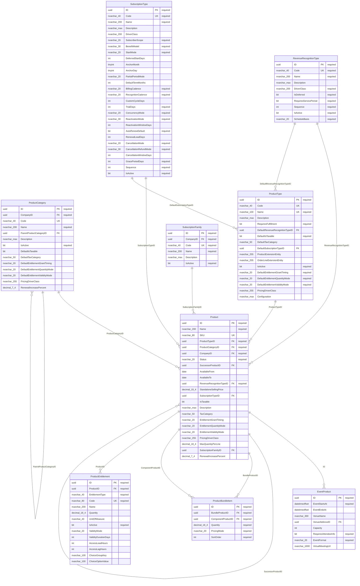

**Reaches outside the app:** `EventProduct.VenueAddressID` → `__mj_BizAppsCommon.Address`, `Product.CompanyID` → `__mj.Company`, `ProductCategory.CompanyID` → `__mj.Company`, `SubscriptionFamily.CompanyID` → `__mj.Company`.

### 2.2 What it costs — price, promotion and who may discount

**Price is resolved, not stored on the product.** The price walk reads no price from `Product`; its
`StandaloneSellingPrice` is used only by bundle expansion, to price `SumOfParts` components and to
split a bundle's price across its `Bundled` ones. `ProductPrice` rows carry the money: each hangs on
a product or on a whole category, with or without a `PriceList`, and is scoped by quantity range,
date window and an optional `Applicability` rule.
`PriceListAssignment` decides which lists a given customer sees, and `PriceTier` carries the bands for
tiered and volume models. The walk that reads all this is in §6.

**`Promotion` is separated from `PromotionCode` on purpose**: one promotion can have many codes
(per-campaign, per-partner, single-use), and `PromotionTarget` scopes what a promotion may apply to.
`SalesAuthority` and `SalesRule` are the guardrails — who is allowed to give value away, and how much.
`OrderConcession` records each concession on an order, whatever form it takes (price, duration, seats,
scope or payment terms), with its computed value and the approval decision. An order cannot be
confirmed, nor its documents sent, while a concession on it is `Pending`.

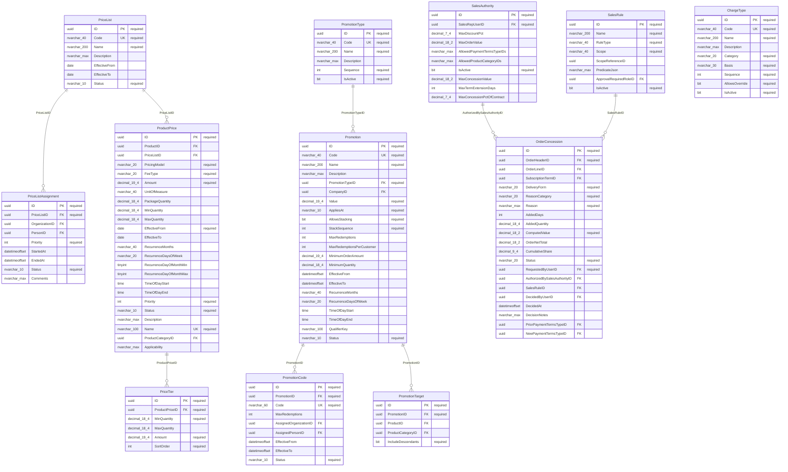

**Leaves this area:** `OrderConcession.NewPaymentTermsTypeID` → `PaymentTermsType`, `OrderConcession.OrderHeaderID` → `OrderHeader`, `OrderConcession.OrderLineID` → `OrderLine`, `OrderConcession.PriorPaymentTermsTypeID` → `PaymentTermsType`, `OrderConcession.SubscriptionTermID` → `SubscriptionTerm`, `ProductPrice.ProductID` → `Product`, `ProductPrice.ProductCategoryID` → `ProductCategory`, `PromotionTarget.ProductID` → `Product`, `PromotionTarget.ProductCategoryID` → `ProductCategory`.

**Reaches outside the app:** `OrderConcession.DecidedByUserID` → `__mj.User`, `OrderConcession.RequestedByUserID` → `__mj.User`, `PriceListAssignment.OrganizationID` → `__mj_BizAppsCommon.Organization`, `PriceListAssignment.PersonID` → `__mj_BizAppsCommon.Person`, `Promotion.CompanyID` → `__mj.Company`, `PromotionCode.AssignedOrganizationID` → `__mj_BizAppsCommon.Organization`, `PromotionCode.AssignedPersonID` → `__mj_BizAppsCommon.Person`, `SalesAuthority.SalesRepUserID` → `__mj.User`, `SalesRule.ApprovalRequiredRoleID` → `__mj.Role`.

### 2.3 The order itself

**The LINE is the unit of money.** A line carries its own `CompanyID` (a denormalised copy of the
product's company, captured at save time), its own journal entry, its own tax, and its own billed and
recognised totals (`BilledToDate`, `RecognizedToDate`). That is what lets one order sell products
belonging to several companies and still produce correct, single-company journal entries.

**Charges and adjustments are allocated, not summed.** `OrderCharge` and `OrderAdjustment` sit at the
header, and their `*Allocation` children push the money down onto specific lines — so a shipping
charge or an order-level discount still lands on a line, which still lands on one company's ledger.

`OrderLinePriceComponent` is the audit trail of the pricing walk: how the number was arrived at, kept
beside the number itself. `OrderLineDimension` holds the tags derived for a line, from `DimensionDefault`
rows and from the line's own facts (§6); the one tag a person types is on the line,
`OrderLine.DimensionID` / `DimensionValueID`, and on save it replaces the derived row on its axis, so
the rows are exactly the tags the line books. `OrderCompanyPolicy` is the per-company orders
settings row, and its ID is the `__mj.Company` ID: promotion stacking, whether unpriced lines are
refused, and the company's default price list, payment terms, pricing driver and renewal increase.
`OrderSequence` is a singleton counter for `ORD-{seq}`, not part of the graph.

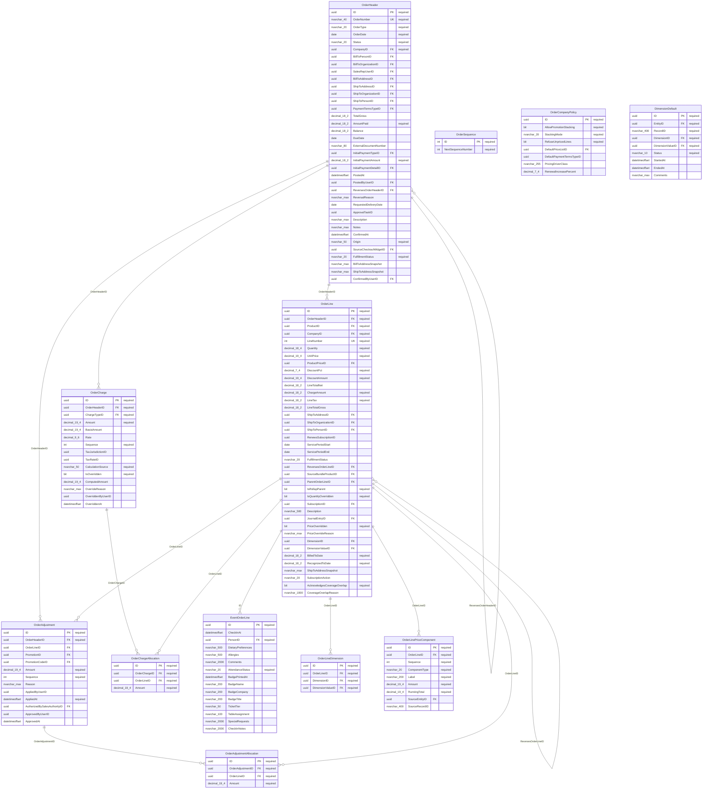

**Leaves this area:** `OrderAdjustment.PromotionID` → `Promotion`, `OrderAdjustment.PromotionCodeID` → `PromotionCode`, `OrderAdjustment.AuthorizedBySalesAuthorityID` → `SalesAuthority`, `OrderCharge.ChargeTypeID` → `ChargeType`, `OrderCompanyPolicy.DefaultPriceListID` → `PriceList`, `OrderHeader.SourceCheckoutWidgetID` → `CheckoutWidget`, `OrderHeader.InitialPaymentDetailID` → `PaymentDetail`, `OrderHeader.InitialPaymentTypeID` → `PaymentType`, `OrderHeader.PaymentTermsTypeID` → `PaymentTermsType`, `OrderLine.ProductID` → `Product`, `OrderLine.ProductPriceID` → `ProductPrice`, `OrderLine.SourceBundleProductID` → `Product`, `OrderLine.SubscriptionID` → `Subscription`.

**Reaches outside the app:** `DimensionDefault.DimensionID` → `__mj_BizAppsAccounting.Dimension`, `DimensionDefault.DimensionValueID` → `__mj_BizAppsAccounting.DimensionValue`, `DimensionDefault.EntityID` → `__mj.Entity`, `EventOrderLine.PersonID` → `__mj_BizAppsCommon.Person`, `OrderCompanyPolicy.ID` → `__mj.Company`, `OrderHeader.BillToAddressID` → `__mj_BizAppsCommon.Address`, `OrderHeader.BillToOrganizationID` → `__mj_BizAppsCommon.Organization`, `OrderHeader.BillToPersonID` → `__mj_BizAppsCommon.Person`, `OrderHeader.CompanyID` → `__mj.Company`, `OrderHeader.ConfirmedByUserID` → `__mj.User`, `OrderHeader.PostedByUserID` → `__mj.User`, `OrderHeader.SalesRepUserID` → `__mj.User`, `OrderHeader.ShipToAddressID` → `__mj_BizAppsCommon.Address`, `OrderHeader.ShipToOrganizationID` → `__mj_BizAppsCommon.Organization`, `OrderHeader.ShipToPersonID` → `__mj_BizAppsCommon.Person`, `OrderLine.CompanyID` → `__mj.Company`, `OrderLine.DimensionID` → `__mj_BizAppsAccounting.Dimension`, `OrderLine.DimensionValueID` → `__mj_BizAppsAccounting.DimensionValue`, `OrderLine.JournalEntryID` → `__mj_BizAppsAccounting.JournalEntry`, `OrderLine.ShipToAddressID` → `__mj_BizAppsCommon.Address`, `OrderLine.ShipToOrganizationID` → `__mj_BizAppsCommon.Organization`, `OrderLine.ShipToPersonID` → `__mj_BizAppsCommon.Person`, `OrderLineDimension.DimensionID` → `__mj_BizAppsAccounting.Dimension`, `OrderLineDimension.DimensionValueID` → `__mj_BizAppsAccounting.DimensionValue`, `OrderLinePriceComponent.SourceEntityID` → `__mj.Entity`.

### 2.4 How a web buyer orders — the embeddable checkout

A `CheckoutWidget` is one company's configured checkout; its questions, choice groups and settings
live in `Configuration`. A `CheckoutWidgetDistribution` publishes it at a public slug, optionally
through a magic-link invite, and can be revoked. A `CheckoutSession` is one anonymous buyer's visit:
its client key, the draft order and payment intent it built, and any auto-renew consent the buyer gave.

After payment the session confirms the order and captures the payment. `CheckoutSessionStep` records
each of those steps per session, how often it was tried and how the last try ended; a failed or
unfinished step is what an operator reviews and replays.

What the buyer told the widget is kept on the order: `OrderCheckoutAnswer` holds one answer per
question, and `OrderLineChoice` one row per option chosen, on the line it was chosen for. A
`ProductEntitlement` template with a `ChoiceGroupKey` grants only on a line carrying that choice, and a
renewal copies the choices. `OrderHeader.Origin` and `SourceCheckoutWidgetID` mark an order the widget
created. See [`checkout-widget-and-session-architecture.md`](checkout-widget-and-session-architecture.md).

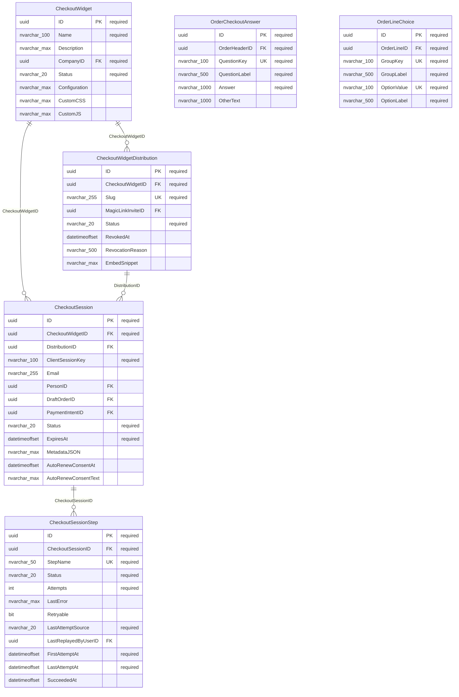

**Leaves this area:** `CheckoutSession.DraftOrderID` → `OrderHeader`, `CheckoutSession.PaymentIntentID` → `PaymentIntent`, `OrderCheckoutAnswer.OrderHeaderID` → `OrderHeader`, `OrderLineChoice.OrderLineID` → `OrderLine`.

**Reaches outside the app:** `CheckoutSession.PersonID` → `__mj_BizAppsCommon.Person`, `CheckoutSessionStep.LastReplayedByUserID` → `__mj.User`, `CheckoutWidget.CompanyID` → `__mj.Company`, `CheckoutWidgetDistribution.MagicLinkInviteID` → `__mj.MagicLinkInvite`.

### 2.5 What the customer keeps getting — subscriptions and entitlements

**`Subscription` is the durable thing; `SubscriptionTerm` is the billable slice.** A subscription
persists across renewals, and its terms are the periods that get billed and recognised; the engine
operates on the term. A subscription row carries no quantity: the seat count is on the order line that
bought each term (`SubscriptionTerm.OrderLineID`), and a renewal copies it from there.

`SubscriptionEvent` is the history; §4 lists its event types. `EntitlementGrant` is what a purchase
actually gives someone: an instance of one of the product's `ProductEntitlement` templates, granted
from an order line and, for a subscription, tied to its term. A payment-gated grant can be held until
the first payment, and a renewal's grant cut off once its order is past due beyond a configured
cutoff; `EntitlementAccessOverride` is a recorded, approved exception to either on one order.
`StoredValueAccount` / `StoredValueTransaction` hold gift cards and other stored value, where the
customer holds value rather than a right. An account credit is not one of them: it is the over-paid
order's negative balance.

A subscription's `CompanyID` comes from the ORDER LINE that created it, not from the order header, so a
mixed-company order puts each subscription on its own seller's books.

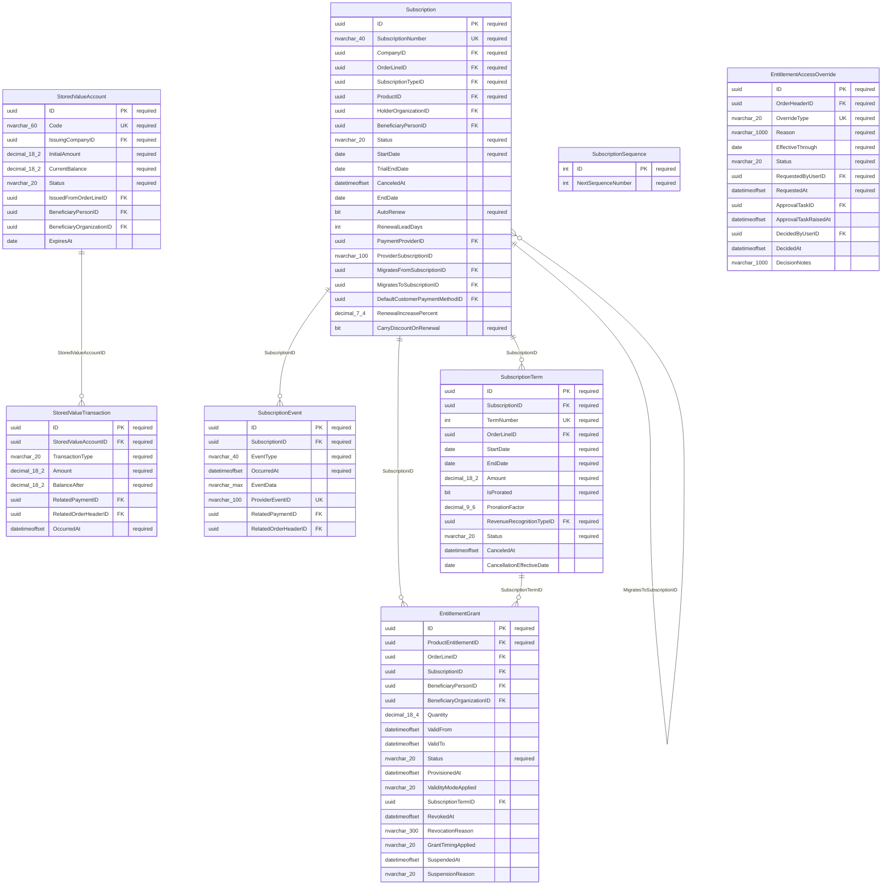

**Leaves this area:** `EntitlementAccessOverride.OrderHeaderID` → `OrderHeader`, `EntitlementGrant.OrderLineID` → `OrderLine`, `EntitlementGrant.ProductEntitlementID` → `ProductEntitlement`, `StoredValueAccount.IssuedFromOrderLineID` → `OrderLine`, `StoredValueTransaction.RelatedOrderHeaderID` → `OrderHeader`, `StoredValueTransaction.RelatedPaymentID` → `PaymentHeader`, `Subscription.DefaultCustomerPaymentMethodID` → `CustomerPaymentMethod`, `Subscription.OrderLineID` → `OrderLine`, `Subscription.PaymentProviderID` → `PaymentProvider`, `Subscription.ProductID` → `Product`, `Subscription.SubscriptionTypeID` → `SubscriptionType`, `SubscriptionEvent.RelatedOrderHeaderID` → `OrderHeader`, `SubscriptionEvent.RelatedPaymentID` → `PaymentHeader`, `SubscriptionTerm.OrderLineID` → `OrderLine`, `SubscriptionTerm.RevenueRecognitionTypeID` → `RevenueRecognitionType`.

**Reaches outside the app:** `EntitlementAccessOverride.ApprovalTaskID` → `__mj_BizAppsTasks.Task`, `EntitlementAccessOverride.DecidedByUserID` → `__mj.User`, `EntitlementAccessOverride.RequestedByUserID` → `__mj.User`, `EntitlementGrant.BeneficiaryOrganizationID` → `__mj_BizAppsCommon.Organization`, `EntitlementGrant.BeneficiaryPersonID` → `__mj_BizAppsCommon.Person`, `StoredValueAccount.BeneficiaryOrganizationID` → `__mj_BizAppsCommon.Organization`, `StoredValueAccount.BeneficiaryPersonID` → `__mj_BizAppsCommon.Person`, `StoredValueAccount.IssuingCompanyID` → `__mj.Company`, `Subscription.BeneficiaryPersonID` → `__mj_BizAppsCommon.Person`, `Subscription.CompanyID` → `__mj.Company`, `Subscription.HolderOrganizationID` → `__mj_BizAppsCommon.Organization`.

### 2.6 Getting paid

**The money that arrived and the money's application are separate tables, because a payment is
not an allocation.** `PaymentHeader` is the receipt; `PaymentLine` hangs off it and records how that
money was applied: against an order, and optionally a specific line or instalment. One cheque paying
three invoices is one header and three lines — which is what lets the ledger and the receivable agree.

**`PaymentDetail` is NOT a third level below them.** The header *points at* it
(`PaymentHeader.PaymentDetailID`), because it is the instrument snapshot — brand, last four, expiry,
bank routing tail, or a stored-value account. It is copied on use, never shared: an order's intended
instrument (`OrderHeader.InitialPaymentDetailID`), a payment's actual one and a saved
`CustomerPaymentMethod` each get their own row. Reading the arrow the other way is the easy mistake here.

`PaymentHeader.ReversesPaymentHeaderID` makes a refund or a bank return a payment of its own that
points at the original; the reversal's negative lines take the cash back off the orders the original
settled, and `ReversalSource` says which of the two it was. `IdempotencyKey`, unique when set, is
what stops a retried request from recording the same money twice.

`PaymentIntent` is the provider handshake (Stripe and friends) held separately from the payment
itself, so an abandoned intent leaves no payment behind, and `PaymentWebhookDelivery` records each
verified webhook delivery from a provider and what was done with it. `PaymentProviderType` /
`PaymentProvider` keep the app provider-agnostic, and `CustomerPaymentMethod` stores the customer's
saved instrument — a token, never a card number.

Immutability here is enforced by TRIGGERS, not by the application: see §5.

```mermaid
erDiagram
    CustomerPaymentMethod ||--o{ PaymentDetail : "SourceCustomerPaymentMethodID"
    PaymentDetail ||--o{ CustomerPaymentMethod : "PaymentDetailID"
    PaymentDetail ||--o{ PaymentHeader : "PaymentDetailID"
    PaymentHeader ||--o{ PaymentHeader : "ReversesPaymentHeaderID"
    PaymentHeader ||--o{ PaymentLine : "PaymentHeaderID"
    PaymentIntent ||--o{ PaymentHeader : "PaymentIntentID"
    PaymentIntent ||--o{ PaymentWebhookDelivery : "PaymentIntentID"
    PaymentProvider ||--o{ PaymentDetail : "PaymentProviderID"
    PaymentProvider ||--o{ PaymentHeader : "PaymentProviderID"
    PaymentProvider ||--o{ PaymentIntent : "PaymentProviderID"
    PaymentProvider ||--o{ PaymentWebhookDelivery : "PaymentProviderID"
    PaymentProviderType ||--o{ PaymentProvider : "PaymentProviderTypeID"
    PaymentType ||--o{ PaymentDetail : "PaymentTypeID"
    PaymentType ||--o{ PaymentHeader : "PaymentTypeID"
    PaymentHeader {
        uuid ID PK "required"
        nvarchar_40 PaymentNumber UK "required"
        uuid ReceivingCompanyID FK "required"
        uuid BillToPersonID FK
        uuid BillToOrganizationID FK
        date PaymentDate "required"
        uuid PaymentTypeID FK "required"
        decimal_18_2 Amount "required"
        decimal_18_2 ProcessingFeeAmount "required"
        decimal_18_2 NetAmount
        uuid PaymentProviderID FK
        uuid PaymentIntentID FK
        uuid PaymentDetailID FK
        nvarchar_100 ProviderChargeID
        nvarchar_100 ProviderRefundID
        uuid ReversesPaymentHeaderID FK
        nvarchar_max ReversalReason
        nvarchar_20 Status "required"
        uuid JournalEntryID FK
        nvarchar_max Description
        nvarchar_max Notes
        nvarchar_200 IdempotencyKey UK
        nvarchar_20 ReversalSource
    }
    PaymentDetail {
        uuid ID PK "required"
        uuid CompanyID FK "required"
        uuid PaymentTypeID FK "required"
        uuid PaymentProviderID FK
        uuid SourceCustomerPaymentMethodID FK
        nvarchar_100 ProviderCustomerRef
        nvarchar_100 ProviderInstrumentRef
        nvarchar_40 Brand
        char Last4
        int ExpiryMonth
        int ExpiryYear
        nvarchar_200 HolderName
        nvarchar_200 BankName
        char RoutingLast4
        char AccountLast4
        nvarchar_20 BankAccountType
        nvarchar_100 ReferenceNumber
        date InstrumentDate
        uuid StoredValueAccountID FK
        uuid SourceOrderHeaderID FK
        nvarchar_max Notes
    }
    PaymentLine {
        uuid ID PK "required"
        uuid PaymentHeaderID FK "required"
        uuid OrderHeaderID FK "required"
        uuid OrderLineID FK
        decimal_18_2 Amount "required"
        datetimeoffset AllocatedAt "required"
        uuid AllocatedByUserID FK
        datetimeoffset BookedAt
        uuid OrderHeaderPaymentScheduleID FK
    }
    PaymentIntent {
        uuid ID PK "required"
        uuid PaymentProviderID FK "required"
        nvarchar_100 ProviderIntentID UK "required"
        nvarchar_30 Status "required"
        decimal_18_2 Amount "required"
        uuid OrderHeaderID FK
        uuid BillToPersonID FK
        uuid BillToOrganizationID FK
        nvarchar_100 ProviderEventID UK
        datetimeoffset LastEventAt
    }
    PaymentProvider {
        uuid ID PK "required"
        uuid PaymentProviderTypeID FK "required"
        uuid CompanyID FK "required"
        nvarchar_200 Name "required"
        nvarchar_200 CredentialsRef
        bit IsLiveMode "required"
        bit IsActive "required"
        uuid CompanyIntegrationID FK
    }
    PaymentProviderType {
        uuid ID PK "required"
        nvarchar_40 Code UK "required"
        nvarchar_200 Name "required"
        nvarchar_max Description
        nvarchar_200 DriverClass
        bit SupportsTokenization "required"
        bit SupportsRefund "required"
        bit SupportsWebhooks "required"
        int Sequence "required"
        bit IsActive "required"
    }
    PaymentType {
        uuid ID PK "required"
        nvarchar_40 Code UK "required"
        nvarchar_200 Name "required"
        nvarchar_max Description
        bit IsReversal "required"
        bit RequiresProvider "required"
        bit RequiresInstrument "required"
        bit RequiresReference "required"
        nvarchar_255 DetailExtensionEntity
        bit BookProcessingFeeInline "required"
        int Sequence "required"
        bit IsActive "required"
    }
    PaymentSequence {
        int ID PK "required"
        int NextSequenceNumber "required"
    }
    CustomerPaymentMethod {
        uuid ID PK "required"
        uuid OwnerPersonID FK
        uuid OwnerOrganizationID FK
        uuid PaymentDetailID FK "required"
        nvarchar_100 Nickname
        bit IsDefault "required"
        bit IsActive "required"
    }
    PaymentWebhookDelivery {
        uuid ID PK "required"
        uuid PaymentProviderID FK "required"
        nvarchar_100 ProviderEventID UK
        nvarchar_100 EventKind
        uuid PaymentIntentID FK
        nvarchar_100 ProviderIntentID
        nvarchar_100 ProviderChargeID
        nvarchar_20 Outcome "required"
        nvarchar_40 ReasonCode
        nvarchar_1000 Reason
        datetimeoffset OccurredAt
        datetimeoffset FirstReceivedAt "required"
        datetimeoffset LastReceivedAt "required"
        int DeliveryCount "required"
    }
```

**Leaves this area:** `PaymentDetail.SourceOrderHeaderID` → `OrderHeader`, `PaymentDetail.StoredValueAccountID` → `StoredValueAccount`, `PaymentIntent.OrderHeaderID` → `OrderHeader`, `PaymentLine.OrderHeaderID` → `OrderHeader`, `PaymentLine.OrderHeaderPaymentScheduleID` → `OrderHeaderPaymentSchedule`, `PaymentLine.OrderLineID` → `OrderLine`.

**Reaches outside the app:** `CustomerPaymentMethod.OwnerOrganizationID` → `__mj_BizAppsCommon.Organization`, `CustomerPaymentMethod.OwnerPersonID` → `__mj_BizAppsCommon.Person`, `PaymentDetail.CompanyID` → `__mj.Company`, `PaymentHeader.BillToOrganizationID` → `__mj_BizAppsCommon.Organization`, `PaymentHeader.BillToPersonID` → `__mj_BizAppsCommon.Person`, `PaymentHeader.JournalEntryID` → `__mj_BizAppsAccounting.JournalEntry`, `PaymentHeader.ReceivingCompanyID` → `__mj.Company`, `PaymentIntent.BillToOrganizationID` → `__mj_BizAppsCommon.Organization`, `PaymentIntent.BillToPersonID` → `__mj_BizAppsCommon.Person`, `PaymentLine.AllocatedByUserID` → `__mj.User`, `PaymentProvider.CompanyID` → `__mj.Company`, `PaymentProvider.CompanyIntegrationID` → `__mj.CompanyIntegration`.

### 2.7 Billing and earning over time — instalments and progress

**Instalments.** An order billed in instalments carries `OrderHeaderPaymentSchedule` rows, one per
instalment, each stamped with the order's company: a due date and an amount the customer agreed to. An
order that had already issued an instalment, or aimed a payment at one, under the earlier per-company
rows keeps those rows. Each row takes its own document number when it is invoiced; the ledger splits it
into one billing entry per product company, and the row records the first. Each row keeps its own
`AmountPaid` and `Balance`, and is frozen once `Invoiced` (§5). `PaymentLine.OrderHeaderPaymentScheduleID`
aims a payment at one instalment; cash that names none counts against invoiced instalments before
scheduled ones, oldest due first. That the instalments add up to the lines they bill is checked in
code, at confirm and at invoicing. An order with no rows is billed as a whole.

**Progress.** A line whose recognition type has `ScheduleBasis` `OnMeasurement` (percentage of
completion) releases nothing at booking. Each `OrderLineProgressMeasurement` row is an attested
observation of cumulative percent complete on a date, and `Orders.RecordProgress` posts the catch-up
to it with its journal entry. A posted row never changes (§5): a correction is a new row that
supersedes it, and the superseded row's recognition is reversed.

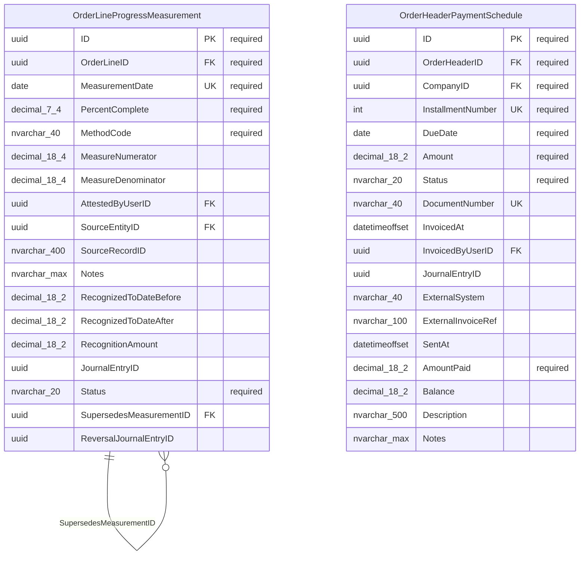

**Leaves this area:** `OrderHeaderPaymentSchedule.OrderHeaderID` → `OrderHeader`, `OrderLineProgressMeasurement.OrderLineID` → `OrderLine`.

**Reaches outside the app:** `OrderHeaderPaymentSchedule.CompanyID` → `__mj.Company`, `OrderHeaderPaymentSchedule.InvoicedByUserID` → `__mj.User`, `OrderLineProgressMeasurement.AttestedByUserID` → `__mj.User`, `OrderLineProgressMeasurement.SourceEntityID` → `__mj.Entity`.

### 2.8 Invoicing through an external system — Bill.com

A company can invoice and collect through an external system instead of natively. The system is a
`PaymentProvider` row whose type is an invoice rail; Bill.com is the one rail today.

`ExternalInvoice` is the authoritative order-to-invoice mapping: one row per billing unit (order,
selling company, and an instalment or the whole order) per attempt. It is written as `Sending` before
the rail is called, and `UQ_ExternalInvoice_LiveUnit` refuses a second live invoice for the same unit.
`ExternalCustomer` maps a bill-to organization or person to the rail's customer. `ExternalPayment` is
every payment the poller has seen on the rail and what it did with it (`Captured` with the
`PaymentHeader` it made, `Held`, `Unmatched`, …), and `PaymentProviderSyncState` is the poll
watermark per provider and rail object. See [`billcom-invoice-rail.md`](billcom-invoice-rail.md).

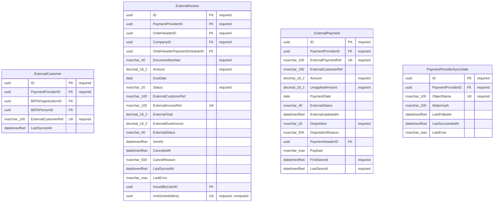

**Leaves this area:** `ExternalCustomer.PaymentProviderID` → `PaymentProvider`, `ExternalInvoice.OrderHeaderID` → `OrderHeader`, `ExternalInvoice.OrderHeaderPaymentScheduleID` → `OrderHeaderPaymentSchedule`, `ExternalInvoice.PaymentProviderID` → `PaymentProvider`, `ExternalPayment.PaymentHeaderID` → `PaymentHeader`, `ExternalPayment.PaymentProviderID` → `PaymentProvider`, `PaymentProviderSyncState.PaymentProviderID` → `PaymentProvider`.

**Reaches outside the app:** `ExternalCustomer.BillToOrganizationID` → `__mj_BizAppsCommon.Organization`, `ExternalCustomer.BillToPersonID` → `__mj_BizAppsCommon.Person`, `ExternalInvoice.CompanyID` → `__mj.Company`, `ExternalInvoice.IssuedByUserID` → `__mj.User`.

### 2.9 Telling other systems — outbound events

`OutboundEvent` is a transactional outbox: an event is written in the same transaction as the change
that caused it (an order confirmed, an entitlement grant's status changed), so it exists exactly when
that change committed, and its ID is the event id consumers dedupe on. `OutboundDelivery` is one row
per event per registered consumer. A dispatcher sends `Pending` rows after commit and retries until
`Delivered` or, past the deadline, `DeadLettered`; `GatesAccess` marks the consumers whose delivery
decides whether a buyer's access is ready. See [`outbound-events.md`](outbound-events.md).

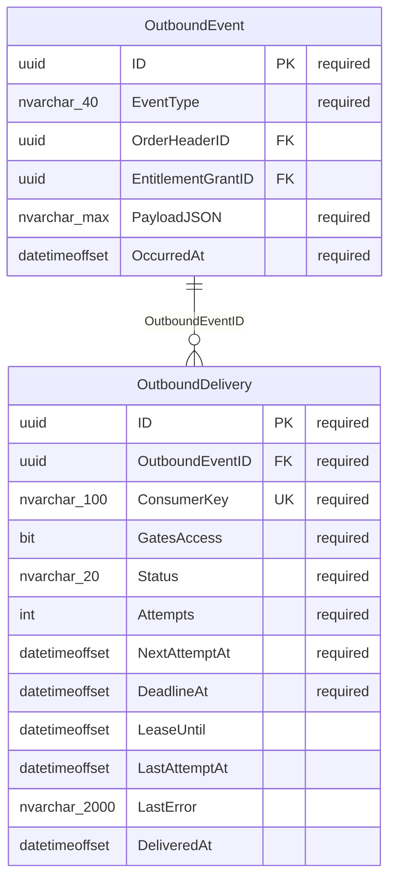

**Leaves this area:** `OutboundEvent.EntitlementGrantID` → `EntitlementGrant`, `OutboundEvent.OrderHeaderID` → `OrderHeader`.

### 2.10 What this customer specifically gets

`CustomerPaymentTerms` and `CustomerTaxExemption` carry per-customer deviations from the default;
`PaymentTermsType` is the list of terms (net days) that customer terms, orders and the company default
point at. `CustomerPaymentTerms` is date-effective and optionally scoped to one selling company, keyed
on an organization OR a person the same way `CustomerTaxExemption` is: the `CK_*_Party` constraints
require exactly one of the two.

The payment-terms walk (§6) reads `CustomerPaymentTerms` at its third rung. The fourth is the selling
company's default, `OrderCompanyPolicy.DefaultPaymentTermsTypeID` (§2.3).

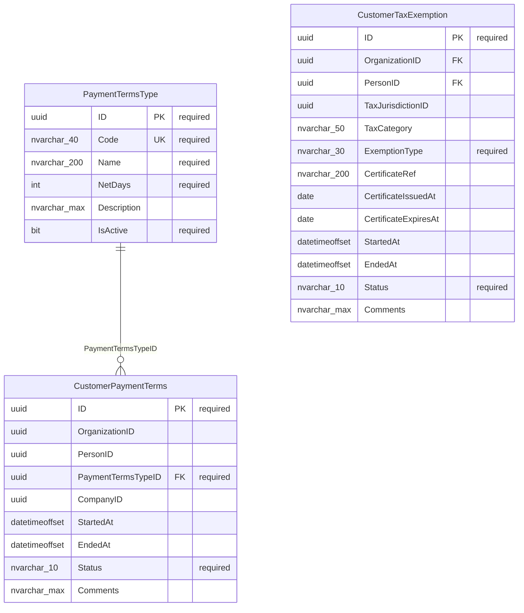

**Reaches outside the app:** `CustomerTaxExemption.OrganizationID` → `__mj_BizAppsCommon.Organization`, `CustomerTaxExemption.PersonID` → `__mj_BizAppsCommon.Person`.

---

## 3. Cross-app reference register

75 foreign keys leave this schema. All point UP the dependency graph (rule 2). Nothing here is
optional trivia: **these are the references that break silently when an upstream app re-bakes its
baseline**, because our generated metadata pins upstream entity IDs by GUID.

```mermaid
erDiagram
    common_Person ||--o{ CheckoutSession : "PersonID"
    common_Person ||--o{ CustomerPaymentMethod : "OwnerPersonID"
    common_Person ||--o{ CustomerTaxExemption : "PersonID"
    common_Person ||--o{ EntitlementGrant : "BeneficiaryPersonID"
    common_Person ||--o{ EventOrderLine : "PersonID"
    common_Person ||--o{ ExternalCustomer : "BillToPersonID"
    common_Person ||--o{ OrderHeader : "BillToPersonID, ShipToPersonID"
    common_Person ||--o{ OrderLine : "ShipToPersonID"
    common_Person ||--o{ PaymentHeader : "BillToPersonID"
    common_Person ||--o{ PaymentIntent : "BillToPersonID"
    common_Person ||--o{ PriceListAssignment : "PersonID"
    common_Person ||--o{ PromotionCode : "AssignedPersonID"
    common_Person ||--o{ StoredValueAccount : "BeneficiaryPersonID"
    common_Person ||--o{ Subscription : "BeneficiaryPersonID"
    MJ_Company ||--o{ CheckoutWidget : "CompanyID"
    MJ_Company ||--o{ ExternalInvoice : "CompanyID"
    MJ_Company ||--o{ OrderCompanyPolicy : "ID"
    MJ_Company ||--o{ OrderHeader : "CompanyID"
    MJ_Company ||--o{ OrderHeaderPaymentSchedule : "CompanyID"
    MJ_Company ||--o{ OrderLine : "CompanyID"
    MJ_Company ||--o{ PaymentDetail : "CompanyID"
    MJ_Company ||--o{ PaymentHeader : "ReceivingCompanyID"
    MJ_Company ||--o{ PaymentProvider : "CompanyID"
    MJ_Company ||--o{ Product : "CompanyID"
    MJ_Company ||--o{ ProductCategory : "CompanyID"
    MJ_Company ||--o{ Promotion : "CompanyID"
    MJ_Company ||--o{ StoredValueAccount : "IssuingCompanyID"
    MJ_Company ||--o{ Subscription : "CompanyID"
    MJ_Company ||--o{ SubscriptionFamily : "CompanyID"
    MJ_User ||--o{ CheckoutSessionStep : "LastReplayedByUserID"
    MJ_User ||--o{ EntitlementAccessOverride : "DecidedByUserID, RequestedByUserID"
    MJ_User ||--o{ ExternalInvoice : "IssuedByUserID"
    MJ_User ||--o{ OrderConcession : "DecidedByUserID, RequestedByUserID"
    MJ_User ||--o{ OrderHeader : "ConfirmedByUserID, PostedByUserID, SalesRepUserID"
    MJ_User ||--o{ OrderHeaderPaymentSchedule : "InvoicedByUserID"
    MJ_User ||--o{ OrderLineProgressMeasurement : "AttestedByUserID"
    MJ_User ||--o{ PaymentLine : "AllocatedByUserID"
    MJ_User ||--o{ SalesAuthority : "SalesRepUserID"
    common_Organization ||--o{ CustomerPaymentMethod : "OwnerOrganizationID"
    common_Organization ||--o{ CustomerTaxExemption : "OrganizationID"
    common_Organization ||--o{ EntitlementGrant : "BeneficiaryOrganizationID"
    common_Organization ||--o{ ExternalCustomer : "BillToOrganizationID"
    common_Organization ||--o{ OrderHeader : "BillToOrganizationID, ShipToOrganizationID"
    common_Organization ||--o{ OrderLine : "ShipToOrganizationID"
    common_Organization ||--o{ PaymentHeader : "BillToOrganizationID"
    common_Organization ||--o{ PaymentIntent : "BillToOrganizationID"
    common_Organization ||--o{ PriceListAssignment : "OrganizationID"
    common_Organization ||--o{ PromotionCode : "AssignedOrganizationID"
    common_Organization ||--o{ StoredValueAccount : "BeneficiaryOrganizationID"
    common_Organization ||--o{ Subscription : "HolderOrganizationID"
    common_Address ||--o{ EventProduct : "VenueAddressID"
    common_Address ||--o{ OrderHeader : "BillToAddressID, ShipToAddressID"
    common_Address ||--o{ OrderLine : "ShipToAddressID"
    acct_Dimension ||--o{ DimensionDefault : "DimensionID"
    acct_Dimension ||--o{ OrderLine : "DimensionID"
    acct_Dimension ||--o{ OrderLineDimension : "DimensionID"
    acct_DimensionValue ||--o{ DimensionDefault : "DimensionValueID"
    acct_DimensionValue ||--o{ OrderLine : "DimensionValueID"
    acct_DimensionValue ||--o{ OrderLineDimension : "DimensionValueID"
    MJ_Entity ||--o{ DimensionDefault : "EntityID"
    MJ_Entity ||--o{ OrderLinePriceComponent : "SourceEntityID"
    MJ_Entity ||--o{ OrderLineProgressMeasurement : "SourceEntityID"
    acct_JournalEntry ||--o{ OrderLine : "JournalEntryID"
    acct_JournalEntry ||--o{ PaymentHeader : "JournalEntryID"
    MJ_MagicLinkInvite ||--o{ CheckoutWidgetDistribution : "MagicLinkInviteID"
    tasks_Task ||--o{ EntitlementAccessOverride : "ApprovalTaskID"
    MJ_CompanyIntegration ||--o{ PaymentProvider : "CompanyIntegrationID"
    MJ_Role ||--o{ SalesRule : "ApprovalRequiredRoleID"
```

| → target | count | from |
|---|---|---|
| `__mj_BizAppsCommon.Person` | 15 | `CheckoutSession.PersonID`, `CustomerPaymentMethod.OwnerPersonID`, `CustomerTaxExemption.PersonID`, `EntitlementGrant.BeneficiaryPersonID`, `EventOrderLine.PersonID`, `ExternalCustomer.BillToPersonID`, `OrderHeader.BillToPersonID`, `OrderHeader.ShipToPersonID`, `OrderLine.ShipToPersonID`, `PaymentHeader.BillToPersonID`, `PaymentIntent.BillToPersonID`, `PriceListAssignment.PersonID`, `PromotionCode.AssignedPersonID`, `StoredValueAccount.BeneficiaryPersonID`, `Subscription.BeneficiaryPersonID` |
| `__mj.Company` | 15 | `CheckoutWidget.CompanyID`, `ExternalInvoice.CompanyID`, `OrderCompanyPolicy.ID`, `OrderHeader.CompanyID`, `OrderHeaderPaymentSchedule.CompanyID`, `OrderLine.CompanyID`, `PaymentDetail.CompanyID`, `PaymentHeader.ReceivingCompanyID`, `PaymentProvider.CompanyID`, `Product.CompanyID`, `ProductCategory.CompanyID`, `Promotion.CompanyID`, `StoredValueAccount.IssuingCompanyID`, `Subscription.CompanyID`, `SubscriptionFamily.CompanyID` |
| `__mj.User` | 13 | `CheckoutSessionStep.LastReplayedByUserID`, `EntitlementAccessOverride.DecidedByUserID`, `EntitlementAccessOverride.RequestedByUserID`, `ExternalInvoice.IssuedByUserID`, `OrderConcession.DecidedByUserID`, `OrderConcession.RequestedByUserID`, `OrderHeader.ConfirmedByUserID`, `OrderHeader.PostedByUserID`, `OrderHeader.SalesRepUserID`, `OrderHeaderPaymentSchedule.InvoicedByUserID`, `OrderLineProgressMeasurement.AttestedByUserID`, `PaymentLine.AllocatedByUserID`, `SalesAuthority.SalesRepUserID` |
| `__mj_BizAppsCommon.Organization` | 13 | `CustomerPaymentMethod.OwnerOrganizationID`, `CustomerTaxExemption.OrganizationID`, `EntitlementGrant.BeneficiaryOrganizationID`, `ExternalCustomer.BillToOrganizationID`, `OrderHeader.BillToOrganizationID`, `OrderHeader.ShipToOrganizationID`, `OrderLine.ShipToOrganizationID`, `PaymentHeader.BillToOrganizationID`, `PaymentIntent.BillToOrganizationID`, `PriceListAssignment.OrganizationID`, `PromotionCode.AssignedOrganizationID`, `StoredValueAccount.BeneficiaryOrganizationID`, `Subscription.HolderOrganizationID` |
| `__mj_BizAppsCommon.Address` | 4 | `EventProduct.VenueAddressID`, `OrderHeader.BillToAddressID`, `OrderHeader.ShipToAddressID`, `OrderLine.ShipToAddressID` |
| `__mj_BizAppsAccounting.Dimension` | 3 | `DimensionDefault.DimensionID`, `OrderLine.DimensionID`, `OrderLineDimension.DimensionID` |
| `__mj_BizAppsAccounting.DimensionValue` | 3 | `DimensionDefault.DimensionValueID`, `OrderLine.DimensionValueID`, `OrderLineDimension.DimensionValueID` |
| `__mj.Entity` | 3 | `DimensionDefault.EntityID`, `OrderLinePriceComponent.SourceEntityID`, `OrderLineProgressMeasurement.SourceEntityID` |
| `__mj_BizAppsAccounting.JournalEntry` | 2 | `OrderLine.JournalEntryID`, `PaymentHeader.JournalEntryID` |
| `__mj.MagicLinkInvite` | 1 | `CheckoutWidgetDistribution.MagicLinkInviteID` |
| `__mj_BizAppsTasks.Task` | 1 | `EntitlementAccessOverride.ApprovalTaskID` |
| `__mj.CompanyIntegration` | 1 | `PaymentProvider.CompanyIntegrationID` |
| `__mj.Role` | 1 | `SalesRule.ApprovalRequiredRoleID` |

**`__mj.Company` is the multi-company spine.** 15 tables reference it, most through a `CompanyID`
column, `OrderLine` among them — that column is what makes a mixed-company order bookable (rule 1).

---

## 4. Value lists (CHECK-constrained)

80 columns are constrained to a closed set at the database. These are the ones worth knowing
before writing a query — a value not on this list cannot be in the column. A column §2 does not mark
`required` can also be NULL, because a CHECK of this shape does not refuse NULL.

| table.column | allowed values |
|---|---|
| `ChargeType.Basis` | `LineNet` · `LineNetPlusCharges` · `OrderNet` · `Flat` |
| `ChargeType.Category` | `Shipping` · `Handling` · `Tax` · `Surcharge` · `Fee` |
| `CheckoutSession.Status` | `Open` · `Processing` · `Confirmed` · `Abandoned` · `Expired` |
| `CheckoutSessionStep.LastAttemptSource` | `Checkout` · `Webhook` · `Replay` |
| `CheckoutSessionStep.Status` | `Running` · `Succeeded` · `Failed` |
| `CheckoutSessionStep.StepName` | `Confirm` · `Capture` |
| `CheckoutWidget.Status` | `Draft` · `Active` · `Disabled` |
| `CheckoutWidgetDistribution.Status` | `Active` · `Revoked` |
| `CustomerPaymentTerms.Status` | `Active` · `Inactive` |
| `CustomerTaxExemption.ExemptionType` | `Resale` · `NonProfit` · `Government` · `Educational` · `Other` |
| `CustomerTaxExemption.Status` | `Active` · `Inactive` |
| `DimensionDefault.Status` | `Pending` · `Active` · `Disabled` |
| `EntitlementAccessOverride.OverrideType` | `WaivePaymentHold` · `DeferCutoff` |
| `EntitlementAccessOverride.Status` | `Requested` · `Approved` · `Rejected` · `Withdrawn` · `Expired` |
| `EntitlementGrant.GrantTimingApplied` | `OnConfirm` · `OnPaidInFull` · `OnFirstPayment` · `OnActivation` |
| `EntitlementGrant.Status` | `Active` · `Suspended` · `Revoked` · `Expired` |
| `EntitlementGrant.SuspensionReason` | `AwaitingPayment` · `PastDue` · `AwaitingActivation` |
| `EntitlementGrant.ValidityModeApplied` | `Perpetual` · `EventWindow` · `FixedDuration` · `SubscriptionTerm` |
| `EventOrderLine.AttendanceStatus` | `Registered` · `Attended` · `No Show` · `Cancelled` |
| `EventProduct.EventFormat` | `In-Person` · `Virtual` · `Hybrid` |
| `ExternalInvoice.Status` | `Sending` · `Sent` · `Canceled` · `Failed` |
| `ExternalPayment.Disposition` | `Captured` · `Held` · `Unmatched` · `Refused` · `Ignored` · `Reapplied` · `ReversalNeeded` |
| `OrderCompanyPolicy.StackingMode` | `Sequential` · `Additive` |
| `OrderConcession.DeliveryForm` | `Price` · `Duration` · `Scope` · `Seats` · `Terms` |
| `OrderConcession.ReasonCategory` | `Retention` · `Referral` · `Other` |
| `OrderConcession.Status` | `Pending` · `Approved` · `Rejected` |
| `OrderHeader.FulfillmentStatus` | `Pending` · `PartiallyFulfilled` · `Fulfilled` · `NotApplicable` · `Returned` |
| `OrderHeader.OrderType` | `Sale` · `Return` · `Cancellation` · `Amendment` · `AccountCredit` |
| `OrderHeader.Status` | `Draft` · `Quoted` · `Confirmed` · `Voided` |
| `OrderHeaderPaymentSchedule.Status` | `Scheduled` · `Invoiced` · `Paid` · `Canceled` · `WrittenOff` |
| `OrderLine.FulfillmentStatus` | `Pending` · `Fulfilled` · `Returned` |
| `OrderLine.SubscriptionAction` | `ExtendExisting` · `CreateNew` |
| `OrderLinePriceComponent.ComponentType` | `Base` · `Rule` · `Adjustment` · `Charge` · `Tax` |
| `OrderLineProgressMeasurement.Status` | `Draft` · `Posted` |
| `OutboundDelivery.Status` | `Pending` · `Delivered` · `DeadLettered` |
| `OutboundEvent.EventType` | `OrderConfirmed` · `GrantStatusChanged` |
| `PaymentDetail.BankAccountType` | `Checking` · `Savings` |
| `PaymentHeader.ReversalSource` | `Refund` · `BankReturn` |
| `PaymentHeader.Status` | `Pending` · `Captured` · `Failed` · `Refunded` · `Disputed` |
| `PaymentIntent.Status` | `RequiresPayment` · `Processing` · `Succeeded` · `Canceled` · `Failed` |
| `PaymentWebhookDelivery.Outcome` | `Applied` · `AlreadyApplied` · `Ignored` · `Rejected` · `Failed` |
| `PriceList.Status` | `Active` · `Inactive` |
| `PriceListAssignment.Status` | `Active` · `Inactive` |
| `Product.EntitlementGrantTiming` | `OnConfirm` · `OnPaidInFull` · `OnFirstPayment` · `OnActivation` |
| `Product.EntitlementQuantityMode` | `PerUnit` · `Flat` |
| `Product.EntitlementValidityMode` | `Perpetual` · `EventWindow` · `FixedDuration` · `SubscriptionTerm` |
| `Product.Status` | `Draft` · `Active` · `Discontinued` · `EOL` |
| `ProductBundleItem.PricingMode` | `Bundled` · `SumOfParts` |
| `ProductCategory.DefaultEntitlementGrantTiming` | `OnConfirm` · `OnPaidInFull` · `OnFirstPayment` · `OnActivation` |
| `ProductCategory.DefaultEntitlementQuantityMode` | `PerUnit` · `Flat` |
| `ProductCategory.DefaultEntitlementValidityMode` | `Perpetual` · `EventWindow` · `FixedDuration` · `SubscriptionTerm` |
| `ProductEntitlement.EntitlementType` | `Feature` · `AccessLevel` · `ResourceQuantity` · `Custom` |
| `ProductEntitlement.ValidityMode` | `Perpetual` · `EventWindow` · `FixedDuration` · `SubscriptionTerm` |
| `ProductPrice.FeeType` | `Standard` · `Setup` · `Recurring` · `Overage` |
| `ProductPrice.PricingModel` | `Flat` · `PerUnit` · `Tiered` · `Volume` · `Package` · `Usage` |
| `ProductPrice.Status` | `Active` · `Inactive` |
| `ProductType.DefaultEntitlementGrantTiming` | `OnConfirm` · `OnPaidInFull` · `OnFirstPayment` · `OnActivation` |
| `ProductType.DefaultEntitlementQuantityMode` | `PerUnit` · `Flat` |
| `ProductType.DefaultEntitlementValidityMode` | `Perpetual` · `EventWindow` · `FixedDuration` · `SubscriptionTerm` |
| `Promotion.AppliesAt` | `Line` · `Order` · `Either` |
| `Promotion.Status` | `Draft` · `Active` · `Paused` · `Expired` |
| `PromotionCode.Status` | `Active` · `Inactive` · `Expired` |
| `RevenueRecognitionType.ScheduleBasis` | `AtBooking` · `OnMeasurement` |
| `SalesRule.RuleType` | `DiscountLimit` · `ConcessionLimit` · `PaymentTermsRequired` · `ProductAuthorization` · `CreditLimit` · `Custom` |
| `SalesRule.Scope` | `Global` · `PerProduct` · `PerCustomer` · `PerSalesRep` |
| `StoredValueAccount.Status` | `Active` · `Depleted` · `Expired` · `Suspended` · `Voided` |
| `StoredValueTransaction.TransactionType` | `Issue` · `Redeem` · `Refund` · `Adjust` · `Expire` |
| `Subscription.Status` | `Active` · `Paused` · `Canceled` · `Migrated` · `Trialing` |
| `SubscriptionEvent.EventType` | `Created` · `Activated` · `TrialStarted` · `TrialEnded` · `PaymentSucceeded` · `PaymentFailed` · `Paused` · `Resumed` · `CancellationRequested` · `Canceled` · `Migrated` · `Extended` · `RenewalOrderSpawned` |
| `SubscriptionTerm.Status` | `Scheduled` · `Active` · `Completed` · `Canceled` · `Lapsed` |
| `SubscriptionType.BenefitModel` | `Holder` · `Individual` · `Organization` |
| `SubscriptionType.BillingCadence` | `Monthly` · `Quarterly` · `Annual` · `Custom` |
| `SubscriptionType.CancellationMode` | `Immediate` · `EndOfTerm` · `EndOfBillingPeriod` |
| `SubscriptionType.CancellationRefundMode` | `NoRefund` · `ProrateUnused` · `FullRefundWithinWindow` |
| `SubscriptionType.ConcurrencyMode` | `AllowMultiple` · `ExtendExisting` · `RejectDuplicate` |
| `SubscriptionType.PartialPeriodMode` | `Prorate` · `ChargeFull` · `ExtendToNextAnchor` |
| `SubscriptionType.ReactivationMode` | `ReactivateExisting` · `AlwaysCreateNew` · `ReactivateWithinWindow` |
| `SubscriptionType.RecognitionCadence` | `Monthly` · `Quarterly` · `Annual` · `MatchBilling` |
| `SubscriptionType.StartMode` | `Immediate` · `Deferred` · `CalendarAnchored` |
| `SubscriptionType.SubscriberScope` | `Organization` · `Person` · `Either` |

The other 109 CHECK constraints are rules rather than lists: exactly one of two party columns, a
window whose end follows its start, a non-negative amount, a column that must hold valid JSON, a
field required by another field's value. §2 does not show them; `sys.check_constraints` has their
bodies.

---

## 5. The rules that live in TRIGGERS, not in the tables

12 business triggers, and they carry two of the app's load-bearing guarantees: totals the database
derives, and records that cannot change once they are booked, captured or decided. A diagram cannot
show either, and code that ignores them will fail at runtime rather than at compile time.

| table | trigger | what it guarantees |
|---|---|---|
| `EntitlementAccessOverride` | `trg_EntitlementAccessOverride_Record` | An update cannot rewrite the override's request or decision. What was requested (order, type, reason, last day, requester) never changes (51023); its status moves only from Requested to Approved, Rejected or Withdrawn, and from Approved to Expired (51024); and the approval task and the decision, once recorded, are not rewritten (51025). The trigger fires on UPDATE only, so a row can still be deleted. That the decision came through the approval task is checked in code (`EntitlementAccessOverrideEntityServer`). |
| `OrderHeader` | `trg_OrderHeader_ImmutableAfterConfirm` | Every rule that freezes a confirmed order header. Its status cannot leave Confirmed (51014), and its date, selling company, order type, reversal link and set bill-to party are history (51013); an empty bill-to party may still be filled, which is what claiming a guest order relies on. A set `BillToAddressID` / `ShipToAddressID` cannot be replaced or cleared, an empty one can be filled only together with its snapshot, and a written snapshot never changes on any order (51015); reporting and the invoice read `BillToAddressSnapshot` / `ShipToAddressSnapshot` on a confirmed order, because the Common `Address` row stays editable. Once `ConfirmedAt` is set, `ConfirmedByUserID` cannot change (51017). Its `PaymentTermsTypeID` changes only to match its latest approved `Terms` `OrderConcession`, prior terms to new (51018); matching the latest, not any, keeps an earlier approval from being replayed, and `DueDate` stays writable. The checks run in that order, so a write that breaks two rules is refused with the first. |
| `OrderHeaderPaymentSchedule` | `trg_OrderHeaderPaymentSchedule_Immutable` | An instalment is frozen once it is past Scheduled. Only a Scheduled row may be deleted (51020); after that its order, company, number, due date, amount and invoice identity cannot change, and it cannot return to Scheduled (51021). `DocumentNumber` and `JournalEntryID` are set once and never cleared or replaced, on any status (51022). That the instalments add up to the lines is checked in code, at confirm and at invoicing, because editing a schedule one row at a time passes through states that do not add up. |
| `OrderHeaderPaymentSchedule` | `trg_OrderHeaderPaymentSchedule_RollupTotals` | Adding, re-amounting or removing an instalment recomputes the order's instalment rollups (`AmountPaid`, `Balance`, `Status` per row). |
| `OrderLine` | `trg_OrderLine_ImmutableAfterConfirm` | Every rule that freezes a confirmed order line. A line of a confirmed order cannot be deleted (51002), and its product, quantity, money and selling company are history (51003). This is why the server short-circuits its own total recomputation once `JournalEntryID` is stamped — a figure it cannot reproduce from stored state alone would be rejected here and roll back the whole confirm. The same set-once address rule as the header holds for a line's own `ShipToAddressID` and `ShipToAddressSnapshot` (51016); the confirm path writes a draft's line snapshots while the header is still Draft for this reason. A set `JournalEntryID` is never cleared or replaced, on any status (51008). `test-harnesses/order-guard-triggers.mjs` and `address-snapshot-triggers.mjs` exercise both triggers. |
| `OrderLine` | `trg_OrderLine_RollupTotals` | The order's `TotalGross`, `Balance` and `FulfillmentStatus`, and its instalment rollups, are recomputed from the lines by the database, so a client cannot supply a total that disagrees with what was booked. |
| `OrderLineProgressMeasurement` | `trg_OrderLineProgressMeasurement_Immutable` | A posted progress observation cannot be changed or deleted (51030), and nothing may promote a Draft one to Posted (51031): `Orders.RecordProgress` writes a row Posted in the same transaction as its journal entry. A correction is a new observation that supersedes the old one. |
| `PaymentDetail` | `trg_PaymentDetail_Immutable` | Once written, an instrument's company, payment type, provider customer and instrument references, brand, last four, expiry, bank name, routing and account tails, reference number and stored-value account cannot change (51009). Not covered: `HolderName`, `BankAccountType`, `InstrumentDate`, `PaymentProviderID`, `SourceCustomerPaymentMethodID`, `SourceOrderHeaderID` and `Notes`. The trigger fires on UPDATE only; the foreign keys from a payment, an order or a saved method keep a referenced detail from being deleted. |
| `PaymentHeader` | `trg_PaymentHeader_ImmutableAfterCapture` | Captured money is frozen. A captured payment cannot be deleted (51004), its amount, fees, type, date, receiving company and customer cannot change (51005), a set `JournalEntryID` is never cleared or replaced (51006), and its status cannot go back (51007). |
| `PaymentHeader` | `trg_PaymentHeader_RollupTotals` | A payment status change (Pending to Captured, say) changes what counts as paid, so the orders its lines touch are recomputed. |
| `PaymentLine` | `trg_PaymentLine_ImmutableAfterCapture` | Once its payment is captured, an applied payment line cannot be deleted (51010), and its amount, order and order line cannot change (51011); the instalment it names (`OrderHeaderPaymentScheduleID`) is not covered. A set `BookedAt` is never cleared or replaced (51012). |
| `PaymentLine` | `trg_PaymentLine_RollupTotals` | The order's `AmountPaid` and `Balance`, and its instalments', are recomputed from the lines of its captured payments. |

The other 68 triggers are CodeGen's `trgUpdate*` `__mj_UpdatedAt` maintainers, one per table.
They are not business logic and are omitted above.

---

## 6. The rules that are not in the schema at all

Four of the app's **resolution walks** decide values the tables only store the result of; the entitlement
settings stored on `EntitlementGrant` and a line's taxability walk the same product chain and are not listed
here. Each tries progressively more general sources; the nearest answer wins, except that among prices
the row's `Priority` decides. They are the reason a column can be non-null and still tell you nothing
about where its value came from.

| walk | order tried | on exhaustion |
|---|---|---|
| **GL account** | product → its category → that category's ancestors → its product type → the line's company | **Refuses the confirm.** Booked money with nowhere to go is worse than no order. |
| **Price** | stated `UnitPrice` → the pricing plugin named by `PricingDriverClass` on the product, its category chain, its type or the company policy (refused when that name has no registered plugin) → a pricing plugin registered by ID for the product, its category or an ancestor, or the company → the default resolver, which picks by `Priority` among the `ProductPrice` rows on the product or inherited from its category chain, from the customer's price lists and the base prices | When no price rule is found, the line is refused unless the company's `OrderCompanyPolicy.RefuseUnpricedLines` is off, and then it books at zero. Rules that exist but do not apply to the quantity or date, or two that tie, are refused either way. |
| **Payment terms** | stated `DueDate` → stated `PaymentTermsTypeID` → `CustomerPaymentTerms` → the selling company's default, `OrderCompanyPolicy.DefaultPaymentTermsTypeID` → due on receipt | Falls through to due on receipt. |
| **GL dimensions** | the tag stated on the line (`OrderLine.DimensionID` / `DimensionValueID`) → tags derived from the line itself (ARR type from its subscription action, vintage from its event's start year) → `DimensionDefault` rows on the product → its category → that category's ancestors → its product type → the line's company, nearest level per dimension; the result, with the line's own tag winning on its axis, is written as `OrderLineDimension` rows | The line books untagged on that dimension. The booking is refused only where the GL account's link requires the dimension. |

Two more behaviours are server-side only:

- **`OrderLine.CompanyID` is derived, never authored.** While the order is open it is stamped from the
  product's company on every save, overwriting whatever a caller passed. Once the order is booked the
  line keeps the company it was sold under, even if the product later moves (51003, §5).
- **A bundle's parent line contributes zero.** An expanded bundle keeps its parent line for the
  invoice to print, but the money lives on the children; the parent's totals are forced to zero so
  the header rollup does not double the order.

---

## 7. Known gaps in this schema

Recorded here because each is a place where the tables and the code disagree, and a reader who trusts
the diagram alone will be misled.

- **Event capacity is not enforced — [#33](https://github.com/MemberJunction/bizapps-orders/issues/33).**
  `EventProduct` has a capacity column and nothing counts against it; an event with capacity 1 sold
  five seats. The obvious fix was written and reverted — `vwOrderLines` does not expose the order's
  status, so every variant either counts abandoned drafts as sold or misses free tickets.
- **Cross-app entity IDs are pinned by GUID.** Our generated metadata references upstream entities by
  ID, so an upstream re-bake silently breaks a from-zero install while every existing instance keeps
  working. The durable fix is resolving cross-app entities by schema + table name.

---

## 8. Deliberately absent

| Not a column here | Where it lives instead | Why |
|---|---|---|
| A price on `Product` that pricing reads | `ProductPrice` rows | Price is per list, per quantity break and per date window. A column could only hold one of those and would decay into "whichever we set last". |
| A company on `OrderHeader` alone | `OrderLine.CompanyID` | A single order legitimately sells products from several companies; a header-only company makes that unrepresentable and puts the wrong company on the ledger. |
| An order reference on accounting's journal entry | `LinkedEntityID`/`LinkedRecordID` | Accounting must not reference its dependents. The polymorphic pair lets a journal entry name its origin without accounting knowing orders exists. |
| A contract link on `OrderHeader` | Nowhere in orders | Orders knows nothing of bizapps-contracts, which does not depend on orders either. Terms agreed in a contract arrive stated on the order, as rungs 1 and 2 of the terms walk (§6). |

<!-- generated by test-harnesses/gen-erd.mjs — do not hand-edit -->
