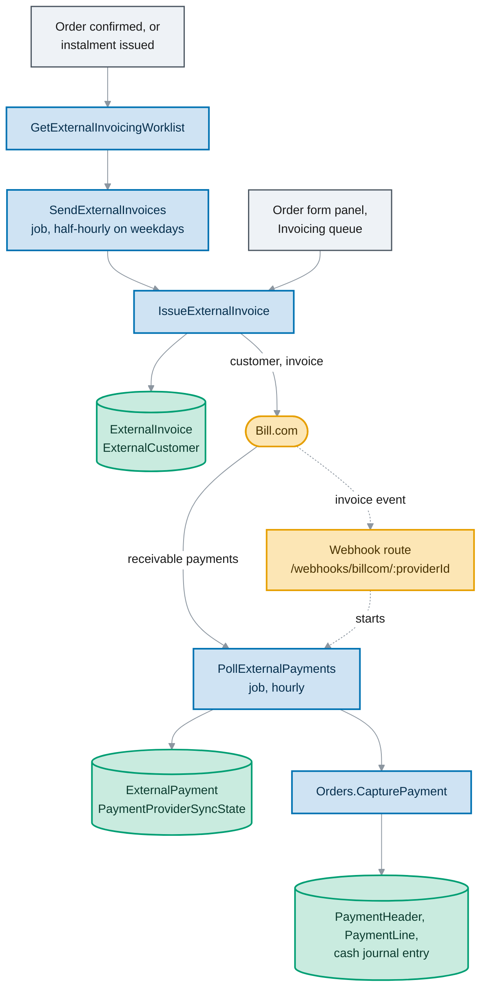

# Bill.com invoice rail

Orders can send a company's invoices to Bill.com (BILL) and record the payments customers make there.
Orders stays the receivable of record: confirming an order books the receivable as before, BILL
delivers the invoice and collects, and each payment BILL reports is captured through
`Orders.CapturePayment`. A company with no `BillCom` payment provider row is unaffected.

This page describes what is built on `next`. The [design spec](superpowers/specs/2026-09-20-billcom-integration-design.md)
records the decisions (D-B1 to D-B12) and what changed them (§13); the
[spike results](superpowers/specs/2026-09-20-billcom-spike-results.md) record what BILL did in the sandbox.
Built for MemberJunction/bc-aidp-next-golive#146, #147, #148 and #242, released in 5.20.0
([release notes](../packages/Server/CHANGELOG.md)); bc-aidp-next-golive#311 changed the billing unit in 5.27.0.

## How it fits together

Nothing in the confirm transaction calls BILL (D-B1); an order save only checks that the bill-to name
fits BILL's customer-name field (bc-aidp-next-golive#280). Confirming an order or issuing an instalment
puts a unit on the worklist, and the sweep or a person sends it. Payments come back by polling, because
BILL has no payment-received event; a verified BILL invoice event only starts the poll sooner.

## Billing units

One BILL invoice is one billing unit: an order, the company that bills it, and an instalment or none.

- **An order with no payment schedule** is one unit, sent through the rail of the order's company
  (`OrderHeader.CompanyID`) whatever company owns each product. It is invoiceable once `Confirmed` and
  numbered as the order. Its BILL invoice has one line per printed invoice row plus `Charges` and
  `Tax`, totalling the order's gross to the cent (`TIE_FAILED` otherwise). An order with money already
  applied is refused (`PART_PAID`), since the invoice would bill that money again.
- **An order with a payment schedule** has one unit per `OrderHeaderPaymentSchedule` row, sent through
  the rail of the row's company. A row is invoiceable once `Orders.IssueInstalmentInvoice` has frozen
  its document number (status `Invoiced`); its BILL invoice is one line for the instalment amount, or
  the order's lines when the schedule has a single row.
- **Service period.** BILL's invoice has no field for it, so it rides in the line text in the format
  our own invoice prints: `Product — description (Oct 1, 2026 – Oct 31, 2026)`. An instalment line
  carries the span of the order's rows, earliest start to latest end.
- **Re-issue.** A cancelled whole-order unit is sent again only on request (`AllowReissue`), as
  `ORD-1234-R1`, `-R2` and so on, since BILL would accept the archived number and the customer would
  hold two different `ORD-1234`s. An instalment is never re-issued; a new schedule row replaces it.
- **Invoices sent per product company before 5.27.0** block the order's own invoice:
  `Orders.IssueExternalInvoice` names the one to cancel first. Schedule rows written per product company
  stay units on that company's rail.

## The rail seam

`BaseInvoiceRail` is the outbound counterpart of `BasePaymentProvider`, registered under
`PaymentProviderType.Code`. It defines `CheckConfiguration`, `EnsureCustomer`, `IssueInvoice`,
`GetInvoice`, `CancelInvoice` and `FetchPaymentsSince`, plus `CustomerNameTargets` and
`InvoiceNumberTargets`, the rail fields a customer name and a document number must fit
(bc-aidp-next-golive#280); a refusal is a `RailResult` with a `Transient` flag for failures a retry
could change. The `BillCom` type resolves to `BillComInvoiceRail`, and to the payment driver
`BillComPaymentProvider`, which refuses checkout verbs and tells the capture path the money is already
collected (`CollectsAtCapture` false). A company has a rail when it has one active `PaymentProvider`
row whose type code is in `INVOICE_RAIL_TYPE_CODES`; two are refused. A second rail needs a provider
type row, a registered subclass with its `Load*` anchor in `packages/Server/src/index.ts`, and its code
added to `INVOICE_RAIL_TYPE_CODES` and the two Angular copies (`RAIL_TYPE_CODES`).

## Where the code is

| Piece | File |
|---|---|
| Rail contract, resolver | [`BaseInvoiceRail.ts`](../packages/CoreEntitiesServer/src/BaseInvoiceRail.ts), [`InvoiceRailResolver.ts`](../packages/CoreEntitiesServer/src/InvoiceRailResolver.ts) |
| BILL rail; the gateway, the only code that calls the connector (tests swap it with `UseBillComGatewaySeams`) | [`BillComInvoiceRail.ts`](../packages/CoreEntitiesServer/src/BillComInvoiceRail.ts), [`BillComGateway.ts`](../packages/CoreEntitiesServer/src/BillComGateway.ts) |
| Payment driver, webhook signature | [`BillComPaymentProvider.ts`](../packages/CoreEntitiesServer/src/BillComPaymentProvider.ts), [`BillComWebhook.ts`](../packages/CoreEntitiesServer/src/BillComWebhook.ts) |
| Pure rules: payload, tie, cancel, adopt, retry class | [`ExternalInvoiceBehavior.ts`](../packages/CoreEntitiesServer/src/ExternalInvoiceBehavior.ts) |
| Pure rules: BILL status table, capture decision, fan-out, tender | [`ExternalPaymentBehavior.ts`](../packages/Entities/src/ExternalPaymentBehavior.ts) |
| The six operations | `packages/CoreEntitiesServer/src/*External*Operation.ts` |
| Scheduler Actions, webhook route | [`send-external-invoices.action.ts`](../packages/Server/src/custom/send-external-invoices.action.ts), [`poll-external-payments.action.ts`](../packages/Server/src/custom/poll-external-payments.action.ts), [`BillComWebhookExtension.ts`](../packages/Server/src/BillComWebhookExtension.ts) |
| Native email refusal (`EXTERNALLY_INVOICED`) | [`DeliveryBehavior.ts`](../packages/CoreEntitiesServer/src/DeliveryBehavior.ts), `DeliveryRecipientResolver.ts`, `packages/Server/src/custom/send-document.action.ts` |
| Order form panel, Invoicing queue, Send/Cancel rules, Billing worklist "Then sends via" column | [`external-invoices.panel.ts`](../packages/Angular/src/lib/form-panels/external-invoices.panel.ts), [`external-invoicing-queue.page.ts`](../packages/Angular/src/lib/pages/receivables/external-invoicing-queue.page.ts), `panels/external-invoice-view.ts`, `pages/receivables/billing.page.ts` |

Screens take their labels from `PaymentProvider.Name`. Unit tests sit in the `__tests__` folders beside
this code. The `billcom-rail` integration bundle
([`billcom-rail.checks.ts`](../packages/IntegrationTests/src/checks/billcom-rail.checks.ts)) runs the
send, cancel, poll and webhook paths against a real database with Bill.com stubbed behind the gateway
seam. [`billcom-live.mjs`](../test-harnesses/billcom-live.mjs) probes a BILL sandbox by hand.

## Remote operations

Defined in [`.orders-billcom-remote-operations.json`](../metadata/remote-operations/.orders-billcom-remote-operations.json),
with inputs and outputs in `metadata/remote-operations/types/orders-*-external-*.ts`. The worklist
needs `orders:read`, the others `orders:write`.

| Operation | What it does |
|---|---|
| `Orders.IssueExternalInvoice` | Sends one unit. Creates the BILL customer if needed (BILL requires an email), then writes a `Sending` row before asking BILL for the invoice, so a second send fails on `UQ_ExternalInvoice_LiveUnit`; reads the invoice back and archives it if the total does not tie. A transient failure leaves the row `Sending` (`UNCERTAIN`) instead of retrying. `Preview` writes nothing. |
| `Orders.CancelExternalInvoice` | Archives a `Sent` invoice. Refused when money is applied to the unit in Orders (`HAS_PAYMENT`) or BILL shows money not yet polled (`PAYMENT_PENDING_ON_RAIL`). Books nothing. |
| `Orders.AdoptExternalInvoice` | Resolves a `Sending` row by recording the invoice BILL already holds, if it is not archived, carries the unit's number and ties. |
| `Orders.GetExternalInvoicingWorklist` | Units invoiceable and not yet sent, computed per request; `IncludeFailed` adds failed and in-flight units. |
| `Orders.SendExternalInvoices` | The sweep: sends worklist units up to `MaxCount` (default 25) and retries transient failures, never cancelled or in-flight units. |
| `Orders.PollExternalPayments` | Reads payments BILL changed since the stored watermark less one day, records each in `ExternalPayment`, and captures the cleared ones. `MaxCount` (default 100) caps new or changed payments per provider. The watermark moves only after a pass with no fault. It also reads HubSpot Payments provider rows ([hubspot-payments.md](hubspot-payments.md)). |

**Capture.** `PAID` is captured; `SCHEDULED` and unknown statuses are held; `VOID`, `CANCELED` and
`ESCHEATED` never are (`BILLCOM_PAYMENT_STATUS`). Every invoice a payment is applied to must be a `Sent`
`ExternalInvoice` of that provider, all for one company, or nothing is captured (`Unmatched`). Capture
runs `Orders.CapturePayment` for the provider's company with `IdempotencyKey` `billcom:<payment id>`
and the tender from BILL's `receivablesType` (`OTHER` means a wire, by agreement with Finance). A
payment voided (`ReversalNeeded`) or re-applied (`Reapplied`) on BILL after capture is flagged, not
corrected. A live pass that leaves flagged, `Unmatched` or `Refused` rows fails with `ATTENTION`, so the
job notifies.

## Actions, jobs and the webhook

- [`metadata/actions/.orders-billcom-actions.json`](../metadata/actions/.orders-billcom-actions.json)
  holds `Send External Invoices` and `Poll External Payments`, each running its operation.
- [`metadata/scheduled-jobs/.orders-billcom-scheduled-jobs.json`](../metadata/scheduled-jobs/.orders-billcom-scheduled-jobs.json)
  runs the send at `0 */30 13-23 * * 1-5` UTC (`MaxCount` 25) and the poll at `0 15 * * * *` UTC
  (`MaxCount` 100). Both ship `Disabled` with `Preview` true: enable a job, read one preview run, then
  set `Preview` to false. The Invoicing queue page runs the send with `Preview` false, whatever its state.
- **The poll job is the switch for recording cash, whoever runs the poll.** `Orders.PollExternalPayments`
  reads the installed poll jobs before a run that would write, and gates each provider by the jobs
  governing it: the jobs whose `PaymentProviderID` names that provider, or, when none does, the jobs
  that name no provider (the shipped one). Among those the most restrictive wins. None installed or
  not `Active` skips that provider with nothing recorded; in Preview that provider runs as a preview
  and the message says so; `Active` and out of Preview records. The run fails only when every
  provider was skipped. A run that asks for `Preview` is always allowed. The queue page's "Check for
  payments now" follows the most permissive job: disabled while every job is off, labelled as a
  preview while none is live, and asks for confirmation before a run that may record; when the jobs
  differ its hint says some providers are previewed or skipped.
- [`V202609291003__v5.20.0__BillCom_Metadata_Sync.sql`](../migrations/V202609291003__v5.20.0__BillCom_Metadata_Sync.sql)
  installs the provider type, the six operations, both Actions and both jobs on a host.
- `POST /webhooks/billcom/:providerId` (declared in `packages/Server/package.json`) checks the
  HMAC-SHA256 signature in `x-bill-sha-signature`, answers 202, and polls that provider only when the
  poll jobs governing it are `Active` and out of Preview.

## Tables

Added by migrations `V202609291000` to `V202609291002`:

| Table | Holds |
|---|---|
| `ExternalInvoice` | One row per attempt to put a unit on a rail (`Sending`, `Sent`, `Canceled`, `Failed`), with BILL's invoice and customer ids, BILL's last-seen total, due amount and status, and the last error. `UQ_ExternalInvoice_LiveUnit` allows one `Sending` or `Sent` row per provider and unit. Payments are matched on this table, never on `OrderHeader.ExternalDocumentNumber`. |
| `ExternalCustomer` | A bill-to organisation or person and its BILL customer id, per provider. Our party id goes to BILL as the account number. |
| `ExternalPayment` | Every payment the poll has seen: `Disposition` (`Captured`, `Held`, `Unmatched`, `Refused`, `Ignored`, `Reapplied`, `ReversalNeeded`), the reason, the `PaymentHeader` it created, BILL's record as JSON. A person sets `Ignored` to close a row. |
| `PaymentProviderSyncState` | The watermark per provider and BILL object, with the last run's times and error. |

`PaymentProvider.CompanyIntegrationID` points a provider row at its `MJ: Company Integrations` row. A
send also stamps the instalment row's `ExternalSystem`, `ExternalInvoiceRef` and `SentAt`, and sets
`OrderHeader.ExternalDocumentNumber` when the order has exactly one live BILL invoice (display only).

## Configuration

Nothing runs until a host sets it up; the 5.20.0 release notes list the steps.

1. **The connector.** MJAPI must load `@memberjunction/connector-bill-com` 0.3.2 or later through
   `dynamicPackages`; no orders package depends on it, and without it every call fails with "No
   connector registered". The `Bill.com` integration and `Bill.com Session` credential type ship with it.
2. **Per company:** an `MJ: Credentials` row of type `Bill.com Session` (username, password,
   organization id, developer key, and `environment` or `apiUrl`), an `MJ: Company Integrations` row
   that uses it, and an active `PaymentProvider` row of type `BillCom` with `CompanyIntegrationID` set
   and `IsLiveMode` matching the credential. Native email then stops for that company.
3. **Credentials stay in MJ.** The connector reads them; Orders stores only the pointer. The rail reads
   only the environment (`apiUrl` outranks `environment`) and refuses to run when it cannot tell
   sandbox from production, or when that disagrees with `IsLiveMode`.
4. **Webhook (optional).** Subscribe to BILL's invoice events with `notificationUrl`
   `https://<host>/webhooks/billcom/<PaymentProviderID>`, and store the `securityKey` under the
   provider row's `CredentialsRef` (the default secret resolver reads `<CredentialsRef>_WEBHOOK_SECRET`
   from the environment). Without it every delivery is refused; the hourly poll still runs.

## Known limits

On `next`, with the connector (0.3.2) and integration engine (6.1.5) this repo installs:

- **No server-side watermark filter** (design §10, U2, not filed). `FetchChanges` ignores the
  watermark, so each poll pages through every receivable payment and filters locally; the gateway
  stops with an error after 200 pages of 100.
- **A BILL login per call.** The gateway creates a connector per call and the connector keeps its
  session per instance, which also keeps the rail clear of MemberJunction/Integrations#427.
- **The webhook** has no replay protection and its polls take no lock (the idempotency key still holds).
- **Native email is refused for every document** of a rail company, quotes and credit memos too.
- **Payments left for a person:** a currency other than the company's functional one (`Refused`), an
  invoice Orders did not send (`Unmatched`), an invoice sent before 5.27.0 by a product company other
  than the order's (`Refused` by `Orders.CapturePayment`; #333), and a void or re-application after capture.
- **Double entry is a process rule** (design §12 Q4): a BILL payment also recorded by hand in Orders is
  booked twice, since `Orders.CapturePayment` accepts over-payment.
- **Smaller gaps.** Retries are decided from error text (`BILLCOM_TRANSIENT`), not the HTTP status.
  After a capture covering several invoices, BILL's status and due amount can be stored on the wrong
  `ExternalInvoice` row (`refreshInvoices` pairs by position; cancel reads BILL directly). The
  instalment stamp and `ExternalDocumentNumber` are best effort, so `ExternalInvoice` is the record to
  trust. `PAYPAL`, `WALLET` and `UNDEFINED` are recorded as ACH. A zero-value unit cannot be sent.
- **BILL words in shared code.** `TenderFor`, the invoice allocation and the re-application messages
  name Bill.com in provider-neutral files (design §13.8). Status tables are per rail
  (`PaymentStatusVocabularyFor`).

## Open questions

- Does creating an invoice in BILL email the customer? Spike S5 saw no sent marker but could not check
  the probe mailbox; it was to be confirmed with a real mailbox before go-live.
- BILL's `SCHEDULED` and `VOID` statuses were never seen live, and no live webhook delivery is recorded.
- Should `ReversalNeeded` and `Reapplied` payments be corrected automatically (design §12 Q8)?
- File U2 upstream, or keep the full scan (design §12 Q9)?
- Do the Stripe and HubSpot cash receipts need the same review of wires and bank fees (design §13.10)?
