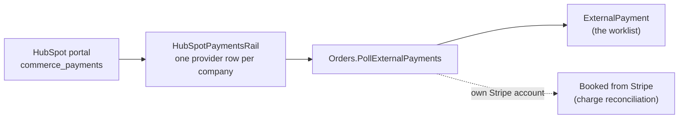

# HubSpot Payments

Payments a company collects through its HubSpot portal (payment links, quotes, HubSpot invoices) are
read by the payment poll when they are made, before HubSpot pays them out to the bank (#482). Each
portal is configured against one company, so its payments land in that company.

## How it fits together

The poll is the same one that reads Bill.com ([billcom-invoice-rail.md](billcom-invoice-rail.md)):
same `ExternalPayment` ledger, same watermark table, same idempotency key (`hubspotpayments:<id>`).
HubSpot is read-only here; Orders issues nothing through it.

## What happens to each payment

`hs_processor_type` says who collected the money, and `hs_latest_status` what became of it.

| HubSpot says | Recorded as | Why |
|---|---|---|
| processor `byo_stripe` | `Ignored` | Collected through the company's own Stripe account. Orders already sees the charge in Stripe, so booking it here too would count it twice. |
| processor `none`, `quickbooks`, `xero`, or none reported | `Ignored` | A record of money collected elsewhere (check, wire, another system). Booked where the money arrived. |
| `processing` | `Held` | Not yet collected. |
| `succeeded` | `Unmatched` | Collected, but no order can be matched yet (below). The reason carries the gross, the fee, the net and the buyer's email. |
| `failed`, `refunded`, `disputed_lost`, never captured | `Ignored` | Nothing kept. |
| `partially_refunded`, a refund in flight, an open dispute | `Held`, or `ReversalNeeded` if already captured | A person books what was kept, refunded or charged back. |
| anything else | `Held` | Unknown statuses are never read as collected (`HUBSPOT_PAYMENT_STATUS`). |

The booked amount is the gross (`hs_initial_amount`). HubSpot's fee (`hs_fees_amount`) stays on the
payload, so the net payout can be matched to the gross payment less the fee.

## Configuration

1. **The connector.** MJAPI loads `@memberjunction/connector-hubspot` (a host that already syncs a
   HubSpot portal has it). The portal's app needs read access to commerce payments.
2. **Per company:** an `MJ: Company Integrations` row for that company's portal, and an active
   `PaymentProvider` row of type `HubSpotPayments` with `CompanyIntegrationID` pointing at it.
   `CredentialsRef` stays empty: the connector reads the portal's credential itself.
3. **The job.** The existing `Poll External Payments` scheduled job reads every active Bill.com and
   HubSpot Payments provider row; nothing else to schedule.

There is no sandbox check. A HubSpot credential carries no sandbox or production flag, so the provider
row's Company Integration alone decides which portal is read.

## Known limits

- **No order matching yet.** A HubSpot payment names its deal only through an association, and the
  published HubSpot connector has no call that reads one record's associations. Every succeeded payment
  is therefore `Unmatched` and the poll reports `ATTENTION` while any are open.
- **The first poll reads the whole portal history** (the watermark starts at 1970). The connector's
  list endpoint reads a refused request as "no data", so the rail always reads through search, which
  raises instead.
- **Payouts are batched.** One bank deposit covers several payments, net of fees. Matching a deposit to
  its payments is bank reconciliation's job, not this poll's.
