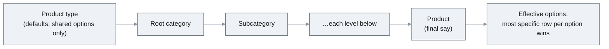

# Product options, with the schema for variant SKUs

**Status:** not started. **Post go-live.** Plan only; no code, migration or metadata in the PR that adds
it. Owner: Boston Gunderson. Reviewers: Robert Kihm, Craig Adam, Andrew. First use: converting
BlueCypress's MJ Central hosting products to options a few weeks after this ships. It builds on the
code-described pricing source that #996 (revenue-band pricing) introduces.

## The problem

A product in Orders is one sellable thing, and its price is chosen from the product, the quantity,
the buyer and the date. Nothing the buyer chooses on the line can change the price. So an offering
sold in three tiers and three sizes has to be entered as nine products: nine flat prices, nine sets of
entitlement templates, and a tier and size that live only in each product's name. A rep picks the
right copy by hand, discounts and renewals attach to one copy, and a report of revenue by tier has to
parse product names. `SubscriptionFamily` exists only because the bands of one subscription are
separate products today.

#996 removed the same duplication for revenue bands, by letting price rules on one product test a
figure Orders reads at pricing time. This plan does it for choices the buyer makes.

What exists today, and why none of it covers this:

| Existing | What it does | Why it is not enough |
|---|---|---|
| `OrderLineChoice` + widget `choiceGroups` | "Choose N of these M" picks at checkout; conditional `ProductEntitlement` templates grant on them; renewals copy them | Defined per checkout widget, not per product; a staff-keyed or Sales-keyed line cannot carry them; price cannot read them |
| `ProductType.OrderLineExtensionEntity` | A per-type companion record holding free-form line detail (attendee, badge) | Descriptive only; price and entitlements do not read it |
| `ProductBundleItem` | A product made of other products | Composition, not choice |
| `ProductPrice` + `Applicability` | One winning price rule per line, chosen by product, category, quantity, dates, parties and (with #996) bill-to revenue | Has no source for the line's own choices |

## What this builds

1. **An option catalog**: options (Tier, Size, Color) and their values, as tables.
2. **Inheritance of which options a product offers**: defaults set on the product type, overridable on
   a category, on each subcategory below it, and finally on the product. The same most-specific-wins
   walk taxability (D73), entitlement policy (D76) and `PricingDriverClass` already use.
3. **The buyer's picks recorded on the order line**, in `OrderLineChoice`, so the renewal copy and
   conditional entitlements that already read that table work for options unchanged.
4. **Price rules that test the picks**, through a new `Option` source in `ProductPrice.Applicability`.
5. **Entitlements that depend on the picks**, using the conditional templates that already exist, with
   one constraint widened.
6. **Validation on both tiers**: required options present, one value each, every value allowed.
7. **The screens**: option catalog, assignment with inheritance shown, line editor selectors, the price
   "When" builder, the checkout widget, the entitlement template editor.
8. **The schema for variant SKUs** (a parent product, each variant's values, a role on the assignment),
   refused on save until the engines are taught about it. That wiring, and inventory, are deferred; see
   [Variant SKUs](#variant-skus-schema-now-wiring-deferred).

## Example: MJ Central hosting

One product, `MJ Central Hosting`, replacing one product per tier and size.

| Option | Values | Assigned at | Required |
|---|---|---|---|
| Tier | Standard, Pro, Enterprise | the product (or a Hosting category, so every hosting product inherits it) | yes |
| Size | Small, Medium, Large | same | yes |

Pricing: nine `ProductPrice` rows on the product, one per combination, each with an `Applicability`
such as `Option.TIER eq PRO and Option.SIZE eq MEDIUM`. A partial rule (`Option.TIER eq ENTERPRISE`,
any size) can sit beside them with a higher `Priority` when one tier prices flat.

Entitlements: `ProductEntitlement` rows conditioned on a pick, for example `SSO` when
`TIER = ENTERPRISE`, or an environment quota whose `Quantity` differs per `SIZE`.

Reporting: ARR by tier and by size is a join from the line to its picks, not a parse of product names.

## Data model

### The option catalog

**`ProductOption`**: `ID`, `CompanyID` (nullable), `Code`, `Name`, `Description`, `SortOrder`, `IsActive`.

- `CompanyID` NULL is a **shared** option, usable by every company and the only kind a product type can
  assign. Set, it is that company's own option, assignable only to that company's categories and
  products. Product types are global and categories are per company (D7), so options need both kinds
  for type-level defaults to exist at all.
- `Code` is unique among shared options, and unique within a company (two filtered unique indexes).

**`ProductOptionValue`**: `ID`, `ProductOptionID`, `Code`, `Label`, `SortOrder`, `IsActive`. Unique on
(`ProductOptionID`, `Code`). A value that a line has used is deactivated, never deleted; the foreign key
from `OrderLineChoice` refuses the delete.

Tables, not `ProductType.Configuration` JSON: a code in JSON has no integrity and no scope, the reason
`SubscriptionFamily` is a table rather than a text code (V202610060655).

### Assignment and inheritance

**`ProductOptionAssignment`**: `ID`, `ProductTypeID`, `ProductCategoryID`, `ProductID` (exactly one set,
by CHECK, the way `ProductPrice` hangs on a product XOR a category), `ProductOptionID`, `IsExcluded`,
`IsRequired`, `DefaultProductOptionValueID` (nullable), `SortOrder`, and `Role` (see
[Variant SKUs](#variant-skus-schema-now-wiring-deferred)). Unique on (scope, `ProductOptionID`) at each
scope, by filtered index.

**`ProductOptionAssignmentValue`**: `ID`, `ProductOptionAssignmentID`, `ProductOptionValueID`. The values
this assignment allows. Unique pair.

The options a product offers are resolved by one walk, from the most general level to the most
specific:

Rules, each to be pinned by a test:

1. **The most specific row for an option wins, whole.** A category row for Size replaces the type's
   row for Size: required flag, default and allowed values together. It does not merge column by
   column. This is how named prices inherit (`collapseInheritedPrices`: a product's `Member` price
   replaces a category's `Member`, it does not stack).
2. **`IsExcluded = 1` removes an inherited option** at that level and everything below it, until a more
   specific row assigns it again.
3. **Allowed values come from the winning row.** No `ProductOptionAssignmentValue` rows means every
   active value of the option.
4. **The default, when set, must be an allowed value.** Checked on save.
5. **Company boundary.** A type-level row may assign only a shared option. A category or product row
   may assign a shared option or one of its own company's.
6. **The walk lives in `OrdersEngine`**, beside `CategoryChain`, as `EffectiveOptions(productID)`. The
   engine caches the four catalog tables (small and stable), so the browser and the server resolve the
   same answer with no round trip, the way client-side pricing already does.

Alternative considered: column-level inheritance (NULL means "ask the next level up"), the D73 shape.
Not chosen, because an option's settings are judged together: "why is Large not offered on this
product" should be answered by one row, not by assembling the required flag from the type, the
allowed values from a subcategory and the default from the product. Open for review.

### Picks on the order line

`OrderLineChoice` gains two nullable columns, set together or not at all (CHECK):

- `ProductOptionID`: which option the pick answers. Set for a product option, NULL for a widget choice.
- `ProductOptionValueID`: the value picked.

For a product option, `GroupKey` is the option's `Code`, `OptionValue` the value's `Code`, and the two
labels are copied at order time, exactly as widget choices are recorded today. That is the reason to
reuse the table rather than add one: `SpawnRenewalsOperation` and `ProviderRenewalBooking` already copy
a line's choices onto its renewal, `EntitlementEngine` already grants conditional templates from them,
and the labels already survive a later rename. A second table would need all three again.

Rules:

- **One value per option per line.** Multi-select remains the widget's `choiceGroups`.
- **A widget choice group may not reuse an option code of the product it sells.** Both write `GroupKey`,
  so a collision would make a widget pick read as an option pick. Refused when the widget is saved.
- **Picks on a confirmed line are frozen.** They decided the line's price and entitlements, so they are
  part of the sale, like its money. The build checks whether the confirmed-order guards
  (V202609231500, V202609291302) already cover `OrderLineChoice`, and adds it if not.

### Entitlement uniqueness

`ProductEntitlement` is unique on (`ProductID`, `Code`), so one entitlement code cannot be granted under
two values (SSO for Pro or Enterprise), and a quota cannot carry a different quantity per size. Replace
that constraint with two filtered unique indexes:

- unconditional: (`ProductID`, `Code`) where `ChoiceGroupKey IS NULL`
- conditional: (`ProductID`, `Code`, `ChoiceGroupKey`, `ChoiceOptionValue`) where `ChoiceGroupKey IS NOT NULL`

Two indexes rather than one wider constraint because SQL Server treats NULLs in a unique constraint as
equal and PostgreSQL treats them as distinct, so one constraint would mean different things on the two
platforms.

Rule, checked on save: every template sharing a `Code` on a product conditions on the **same** option,
so at most one of them matches any line and a line never gets two grants of one code.

### Gateway prices

`PaymentProviderPrice` maps a gateway price to the product an order created from a payment carries. An
optioned product sold through a gateway has one gateway price per combination, so the mapping must
also carry the picks: **`PaymentProviderPriceOptionValue`** (`PaymentProviderPriceID`,
`ProductOptionValueID`), copied onto the created line. Needed only if an optioned product is sold
through a payment link or hosted checkout with no order behind it.

## Pricing

- **A new source, `Option`**, in the applicability bag and in the price "When" builder. Its fields are
  the option codes and each field's value is the picked value's code. No entity backs it, so it is
  described in code, the way #996 describes `BillToOrganizationRevenue`. The builder lists the options
  effective for the product or category the price row hangs on.
- **The pricing context carries the line's picks.** For a saved line they are read with the line's
  order, once per pricing pass (the pricing service already builds the bag once per order walk). For a
  line not saved yet (order entry, the checkout preview, a deal line in Sales) the caller passes the
  picks in, the way `OrderFallback` carries an unsaved header today. `BuildLinePriceContext` is shared
  by the price-override gate and the concession gate, so both see the picks with no further change.
- **One winning rule, as today.** A full matrix is one row per combination; partial rules and `Priority`
  cover the rest. Adding a tier price to a size surcharge is out of scope: the engine does not stack
  rules, and a price-adjustment column on option values would be a second pricing system.
- **A required pick that is missing refuses pricing** with a named error listing the option, the same
  shape as #996's `RevenueBandRequiredError`, rather than pricing a guess.
- **Price rules on a category see options too.** A Hosting category can carry the matrix once for every
  hosting product.

## Validation

In the shared `OrderLineEntity`, so the editor, the checkout widget and the server agree; the server's
check is the one that counts, as for widget choices today:

- every required effective option has a pick;
- every pick is for an option effective on the line's product, with an allowed, active value;
- one pick per option.

## Subscriptions

- **Renewals carry the picks.** The two renewal paths copy choices already; they must also copy the two
  new columns.
- **A tier change at renewal** is a pick changed on the renewal order while it is still `Draft` (D20).
  Renewal pricing today is the prior term's price plus the renewal increase; a renewal whose picks
  differ from its term's must price from the rules instead. See [Open questions](#open-questions).
- **A mid-term tier change is out of scope.** No internal upgrade path exists today: `AmountChange` only
  lowers a term, and a plan change made at the gateway is reported (`GatewayPlanChanged`), not mirrored.
- **An optioned product does not need a `SubscriptionFamily`.** Its tiers are one product, so the
  existing same-product concurrency rules (`SubscriptionType.ConcurrencyMode`,
  `OrderLine.SubscriptionAction`) already govern them.

## Reporting

CodeGen joins the new foreign keys into `OrderLineChoice`'s view; mark `ProductOption.Name` and
`ProductOptionValue.Label` as the name fields so the view carries them. Revenue, ARR or seats by tier
and size is then a join from `OrderLine`. No reporting view is needed in this build.

## Screens

| Screen | Change |
|---|---|
| Catalog | An options page: options, values, sort order, shared vs company |
| Product type, category and product forms | The options this level assigns, plus the inherited ones, each showing which level it comes from, the way inherited prices show `InheritedFrom` |
| Order line editor | Selectors for the product's effective options; the line re-prices when a pick changes |
| Price "When" builder | The `Option` source |
| Checkout widget | Renders the product's effective options with no widget configuration, the way extension fields are discovered |
| Entitlement template editor | Choose the condition from the product's options and values rather than typing keys |
| bizapps-sales deal line editor | The same selectors on a deal's lines. Cross-repo follow-up; Sales still never prices |

Per `docs/ui-architecture.md`, none of this is a data service: resolution lives in `OrdersEngine`,
validation on the entity, and the screens bind to both.

## Variant SKUs: schema now, wiring deferred

BlueCypress sells nothing physical, so it does not need a SKU per combination. Physical goods will,
because stock and cost attach to a SKU: a shirt in navy, size L, is a different thing on a shelf from
the same shirt in red. The schema for that ships in this build so the option model is settled once and
the later work is additive; the engines that would use it do not.

**What ships:**

- `Product.ParentProductID`, nullable, with a CHECK against pointing at itself. One level only: a parent
  never has a parent. That cannot be a CHECK across rows, so the entity server refuses it, and CodeGen
  must not treat the column as a recursive hierarchy (the cleanup in V202608182055 shows what happens
  when it does).
- **`ProductVariantValue`**: `ID`, `ProductID` (the variant), `ProductOptionID`, `ProductOptionValueID`.
  Unique on (`ProductID`, `ProductOptionID`): one value per axis.
- `ProductOptionAssignment.Role`: `LineOption` (default; everything above) or `Variant` (the option
  defines a SKU).

**What is refused until the wiring exists:** setting `ParentProductID`, writing `ProductVariantValue`,
and `Role = 'Variant'`, each with a message saying variants are not supported yet. Two small checks in
the entity servers. Without them, a variant row would quietly miss its template's prices, tax settings
and entitlements, because no walk knows about the template yet. D84 retired tables that looked
authoritative while nothing used them; refusing writes keeps these from being mistaken for a working
feature.

**Deferred, to be planned when physical goods arrive:**

- generating the variants from chosen values, and keeping the combinations unique among siblings;
- inserting the template into every walk: named prices, taxability, GL accounts, entitlement policy,
  `PricingDriverClass`, entitlement templates;
- ordering a template resolves to its variant; the order line always references the variant;
- a grid that groups variants by their option values (rows one axis, columns another), built from
  `ProductVariantValue` and the options' sort order, never from product names;
- one report of picks across both kinds, so "sales by size" works whether size was a pick or a SKU;
- priced line options as add-on products on a child line (`OrderLine.ParentOrderLineID`).

**Inventory and costing are a separate system**, likely their own Open App: accounting lists inventory
and cost of goods as outside its scope. Variant SKUs are the prerequisite, since stock is held per
variant row. Not needed by BlueCypress.

## Decisions

| # | Decision | Alternative not chosen |
|---|---|---|
| 1 | Options inherit type → category chain → product; the most specific row per option wins whole | Column-level inheritance (D73 shape) |
| 2 | Options are tables | `ProductType.Configuration` JSON |
| 3 | Shared options (`CompanyID` NULL) and company options; only shared ones at type level | Company-only options, which leaves type-level defaults impossible. **Robert to confirm against D7.** |
| 4 | Picks are stored in `OrderLineChoice` | A new table, which repeats the renewal copy and entitlement matching |
| 5 | List options with one value each. Free text stays on the extension entity; multi-select stays in widget choice groups | A value type with free text and multi-select in this build |
| 6 | Price by matrix through `Applicability`, one winning rule | A price adjustment per option value |
| 7 | Variant schema ships, refused on save until wired | Ship nothing for variants now; or ship the schema unguarded |

## Open questions

1. **Renewal pricing when picks change.** Price from the rules (proposed), or keep the prior price plus
   the increase and let the rep override?
2. **The Sales deal editor**: in this build, or the Sales follow-up straight after?
3. **Existing subscribers on per-tier products.** Renewals book on the subscription's own product, so
   converting MJ Central's live subscribers to the new product needs either a planned migration or a
   way to switch product at renewal. Which, and does the conversion wait for it?
4. **Required-option defaults.** Should a required option with a default pre-fill the line, or must the
   rep or buyer always pick?

## Build order

1. One migration: the six tables, the `OrderLineChoice` columns, `Product.ParentProductID`, the
   `ProductEntitlement` index swap, with CodeGen captured below its banner and a minor changeset.
2. `OrdersEngine`: cache the catalog; `EffectiveOptions(productID)`; unit tests for the walk (type
   only, category override, subcategory override, product override, exclusion and re-assignment,
   company boundary, default outside the allowed values).
3. `OrderLineEntity` validation, the entity-server checks, and the variant refusals.
4. Pricing: the `Option` source, the context with saved and unsaved picks, the missing-pick refusal.
5. Entitlements: the same-option rule for shared codes.
6. Renewals: copy the new columns; re-price when picks differ (per open question 1).
7. Screens.
8. A `product-options` integration bundle: options resolved through each level, a matrix price, a
   missing pick refused, an entitlement granted by tier, a renewal carrying its picks, variant writes
   refused. Add it to `registry-parity.test.ts`.
9. Update `docs/HOW_THE_SYSTEM_WORKS.md` and `docs/ERD.md`, and move this plan to `archive/` with a
   status line.

## After it ships: converting MJ Central hosting

This is BlueCypress catalog data in BlueCypress's instance, not `metadata/`, which ships to every host
and holds only vocabulary. Create Tier and Size, assign them to the hosting product (or its category),
add the nine price rules and the conditional entitlements, map any gateway prices with their picks,
and retire the per-tier products once open question 3 is settled.
